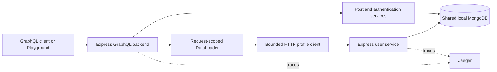

# GraphQL Engineering Lab

A Docker-based learning project for exploring GraphQL performance, API design, authorization, failure handling, and schema evolution with Express, TypeScript, and MongoDB.

The application began as a monolith to make the N+1 problem visible, then moved public post-author lookups into a separate user service. The focus is understanding engineering tradeoffs through small changes, tests, traces, and load experiments.

## Built with Codex assistance

This project was developed with help from **OpenAI Codex**. Codex assisted with design discussions, explanations, implementation suggestions and edits, tests, and documentation. Development proceeded through small reviewed checkpoints, with the developer running and verifying the application. This repository records a learning process, not a claim that the work was created without AI assistance.

## What you can learn

| Topic | Exercise |
| --- | --- |
| N+1 and DataLoader | Batch repeated author lookups, restore key order, and isolate request caches |
| Query protection | Bound pagination, validate query depth, and reject operations over a cost budget |
| Database performance | Inspect MongoDB query plans and use a compound index |
| Authentication | Verify passwords with asynchronous scrypt and issue revocable server-side sessions |
| Authorization | Enforce post visibility, ownership, administrator access, and publication rules in services |
| Schema evolution | Add displayName, retain deprecated name, and check structural compatibility in CI |
| Distributed GraphQL | Call a separate profile service with bounded requests, deadlines, and partial failures |
| Observability | Follow one trace across services and correlate it with request logs |
| Load testing | Use k6 to measure correctness and latency under concurrency, retaining measurement caveats |

Federation is compared in the design documentation; this implementation uses explicit HTTP delegation, not a federated router.

## Architecture



The backend owns the public GraphQL schema, sessions, and post authorization. The user service exposes only public profiles through an authenticated internal batch endpoint. Both currently use the same MongoDB database: this is transitional shared storage, not complete independent data ownership.

## Prerequisites

- Docker Engine or Docker Desktop with Docker Compose support.
- A Bash-compatible terminal, such as the project's WSL Ubuntu terminal.
- Git for obtaining the repository. A browser is useful for Playground and Jaeger.

Node.js, npm, TypeScript, MongoDB, and k6 run in containers. Do not install them on the host for these instructions. Commands below run from the repository root. Bash backslashes continue commands onto the next line; do not put spaces after them.

## First-time setup

These instructions target a fresh checkout. If you already have a working .env and database, preserve them and skip initialization steps you have completed.

### 1. Get the source

```sh
git clone https://github.com/aruprakshit/GraphQL-Engineering-Lab.git graphql-lab
cd graphql-lab
```

### 2. Create local environment configuration

The required variables are listed in [.env.example](.env.example). Create a new .env using your actual UID/GID and a generated service credential:

```sh
# Fresh checkout only: this writes .env. Do not overwrite existing configuration.
{
  printf 'LOCAL_UID=%s\nLOCAL_GID=%s\n' "$(id -u)" "$(id -g)"
  docker run --rm node:26-alpine node -e \
    'console.log("USER_SERVICE_TOKEN=" + require("node:crypto").randomBytes(32).toString("hex"))'
} > .env
```

.env is ignored by Git. The service token authenticates backend-to-user-service requests; it is separate from browser session cookies and user passwords. It must contain 64 lowercase hexadecimal characters. Do not commit or log its value.

LOCAL_UID and LOCAL_GID let application containers create files with your ownership rather than root ownership. Compose reads these settings from .env, so you do not need to export them for every command.

### 3. Create dependency volumes

```sh
docker volume create graphql-lab-node-modules
docker volume create graphql-lab-user-service-node-modules
```

Make each volume writable by your UID/GID:

```sh
docker run --rm \
  -v graphql-lab-node-modules:/app/node_modules \
  node:26-alpine \
  chown "$(id -u):$(id -g)" /app/node_modules

docker run --rm \
  -v graphql-lab-user-service-node-modules:/app/node_modules \
  node:26-alpine \
  chown "$(id -u):$(id -g)" /app/node_modules
```

A named volume is storage managed by Docker. The container path /app/node_modules is where that storage is mounted; there is no need to create a host node_modules directory. Dependency volumes are separate from the MongoDB data volume.

### 4. Install locked dependencies

```sh
docker compose run --rm --no-deps backend npm ci
docker compose run --rm --no-deps user-service npm ci
```

Compose reuses each service's configured working directory, source mount, dependency volume, and UID/GID. These commands override npm run dev, so no application server starts during installation.

### 5. Start applications and prepare fixtures

```sh
docker compose up -d mongo jaeger user-service backend

docker compose exec backend npm run seed
docker compose exec backend npm run db:indexes

docker compose ps
docker compose logs --tail=30 backend user-service
```

On an empty database, the seed creates three users and 30 published posts. Repeating it does not insert duplicates; it does not reset your experiments or provision login accounts.

The index command ensures the post author/index ordering index, normalized-username uniqueness, and session-expiry TTL index. Session validity is checked by application code; TTL cleanup is background housekeeping.

### 6. Open the tools

| Tool | Address |
| --- | --- |
| GraphQL Playground | http://localhost:4000/playground |
| GraphQL endpoint | http://localhost:4000/graphql |
| Backend liveness | http://localhost:4000/health |
| Jaeger | http://localhost:16686 |

The user service listens on port 4001 inside Docker, without a published host port. The backend calls http://user-service:4001; localhost inside a container refers to that container itself.

## Learning walkthrough

### Batch authors and paginate posts

Run in Playground:

```graphql
query ExplorePosts($after: String) {
  posts(first: 5, after: $after) {
    edges {
      cursor
      node {
        id
        title
        status
        author {
          id
          displayName
          name
        }
      }
    }
    pageInfo {
      hasNextPage
      endCursor
    }
  }
}
```

For the next page, pass the returned endCursor as the after variable. Pagination is ordered by string ID, not creation time. name remains available but is deprecated in favor of displayName.

In Jaeger, inspect the POST /graphql trace under graphql-engineering-lab. Author batches produce user-service.batch client spans followed by incoming spans under graphql-user-service. Several posts sharing an author should not require one remote request per post. DataLoader results and cache behavior can also be checked against the seeded data:

```sh
docker compose exec backend node --import tsx/esm src/check-loader.ts
```

That standalone command omits telemetry preloading; use the running GraphQL application for distributed trace inspection.

### Provision an account and authenticate

Provision a login for the seeded Ada profile:

```sh
docker compose exec backend npm run account:provision -- \
  --user-id user-1 --username ada
```

The command prompts for a password and confirmation without echoing them. Passwords must contain 15 to 128 Unicode code points and fit the 1,024-byte input limit. Use --admin only when deliberately provisioning an administrator. Provisioning enforces account uniqueness; repeating it is not a password-reset procedure.

In Playground, add this request header for login and logout:

```json
{
  "X-GraphQL-Auth": "1"
}
```

Use the exact configured origin, http://localhost:4000. The browser supplies Origin; changing to 127.0.0.1 or another port changes the origin.

```graphql
mutation Login($input: LoginInput!) {
  login(input: $input) {
    user {
      id
      name
      role
    }
  }
}
```

Provide input.username and input.password through Playground's Variables pane using the account just provisioned. The response sets an HttpOnly session cookie. Ensure Playground sends same-origin cookies, then check identity:

```graphql
query CurrentUser {
  me {
    id
    name
    role
  }
}
```

See [authentication](docs/authentication/README.md) and [the login contract](docs/authentication/login.md) for detailed cookie, origin, login-limit, and error behavior. Never paste real passwords or tokens into committed query examples, logs, or traces.

### Exercise post authorization

While authenticated:

```graphql
mutation CreateDraft {
  createDraft(input: { title: "My authorization experiment" }) {
    id
    title
    status
    author {
      displayName
    }
  }
}
```

Use the returned ID in these operations:

```graphql
mutation EditDraft($id: ID!) {
  updatePost(id: $id, input: { title: "Updated experiment" }) {
    id
    title
    status
  }
}

mutation PublishDraft($id: ID!) {
  publishPost(id: $id) {
    id
    status
  }
}
```

Run one mutation at a time. Compare an author's draft access with anonymous access or another provisioned user's session. Publishing requires a draft; publishing again is a business-rule conflict. Posts are filtered for visibility before pagination.

```graphql
query MyVisibleDrafts {
  posts(first: 5, status: DRAFT) {
    edges {
      node {
        id
        title
        status
      }
    }
  }
}
```

This lists visible drafts, not every user's drafts. Log out when finished:

```graphql
mutation Logout {
  logout
}
```

### Observe partial failure

```sh
docker compose stop user-service
```

Repeat the posts query with authors. Expect available post data, null authors, and SERVICE_UNAVAILABLE field errors. A query selecting only post IDs and titles should still succeed. Then restore the service:

```sh
docker compose start user-service
```

GraphQL errors can accompany HTTP 200; inspect errors as well as data. A missing profile returns null without a dependency error, whereas an unavailable service is an error. Authentication keeps its existing backend database path during a profile-service outage.

## Checks and experiments

```sh
# Backend
docker compose exec backend npm run format:check
docker compose exec backend npm run typecheck
docker compose exec backend npm test
docker compose exec backend npm run schema:check

# User service
docker compose exec user-service npm run format:check
docker compose exec user-service npm run typecheck
docker compose exec user-service npm test

# Isolated MongoDB integration tests
docker compose --profile test run --rm integration-tests
docker compose --profile test run --rm user-service-integration-tests

# Load experiments: run separately
docker compose --profile loadtest run --rm -e VUS=1 k6
docker compose --profile loadtest run --rm -e VUS=5 k6
docker compose --profile loadtest run --rm -e VUS=10 k6
```

Use npm run format in the respective application container to apply formatting. Formatting scripts operate within their application directories. CI runs checks and tests for both applications, including backend schema compatibility.

Do not regenerate the schema baseline merely to hide a breaking change. Structural checks complement resolver tests; they do not prove client migration or authorization correctness.

## Documentation map

| Guide | Read it for |
| --- | --- |
| [Distributed GraphQL](docs/distributed-graphql.md) | Ownership, HTTP contracts, deadlines, batching, tracing, and partial failures |
| [Authentication](docs/authentication/README.md) | Credentials, password verification, sessions, cookies, me, and logout |
| [Authorization](docs/authorization.md) | Visibility, ownership, mutations, and business rules |
| [Query complexity](docs/query-complexity.md) | Cost calculations and pre-execution budgets |
| [Query depth](docs/query-depth.md) | Nested paths, repeated fields, and ESM compatibility |
| [Query plans](docs/query-plans.md) | MongoDB explain output and indexes |
| [Schema evolution](docs/schema-evolution.md) | Deprecation, compatibility checks, and baseline policy |
| [Tracing](docs/tracing.md) | Jaeger inspection and service-level spans |
| [Request timing](docs/request-timing.md) | Request correlation and the earlier timing exercise |
| [Load testing](docs/load-testing.md) | Historical and distributed measurements and their limitations |
| [Debugging tests](docs/debugging-tests.md) | Docker-only Node debugging with Chrome and single-test selection |

Some earlier exercise documents describe historical stages. Use the current Compose file and the distributed-flow guide for the final runtime architecture.

## Historical monolith checkpoint

The annotated tag v0.1.0-monolith marks the working application before distributed-service implementation:

```sh
git show v0.1.0-monolith --no-patch
git worktree add ../graphql-lab-monolith v0.1.0-monolith
```

This checkout is optional; you do not need it to continue development. Follow the files at the tag when running that version. A Git tag captures source, not MongoDB data or Docker volumes.

## Persistence, shutdown, and separate checkouts

```sh
docker compose down
```

Normal down removes containers and the network while retaining named database storage. Avoid down -v unless you intend to remove the Compose-managed data volume.

The two dependency volumes use explicit external names. A second checkout reuses those names by default, even with a different Compose project name. A different project name isolates ordinary project-scoped database volumes but does not rename external dependency volumes or change host ports. For fresh-checkout verification, use dedicated dependency volumes and nonconflicting ports or stop the original application without deleting its data. Do not claim isolation based only on a new folder name.

Follow [isolated setup verification](docs/setup-verification.md) for a separate-checkout procedure with dedicated volumes and ports. It requires Docker Compose 2.24.4 or newer for the explicit verification override.

Changing Compose environment values requires recreating the affected containers; source watching alone does not apply environment changes. If a saved schema edit is not reflected in Playground, restart the backend and retry.

## Known limitations

- This is a development and learning setup, not a production deployment template.
- Services share MongoDB storage, and database-level permission isolation is not implemented.
- Local service-to-service HTTP and a shared service token do not replace production transport and identity design.
- Deadlines apply per profile batch; aggregate GraphQL operation limits and bounded shutdown remain concerns.
- One corrupt stored profile fails its whole batch; per-ID error outcomes are intentionally outside scope.
- Short local load runs share host resources. Timing anomalies remain unresolved, and historical comparisons do not isolate architecture as the only changed variable.
- Jaeger uses in-memory storage; restarting it loses stored traces. Export is best effort.
- Federation is documented as a tradeoff, not implemented. Public schema compatibility checks do not track real client field usage.

