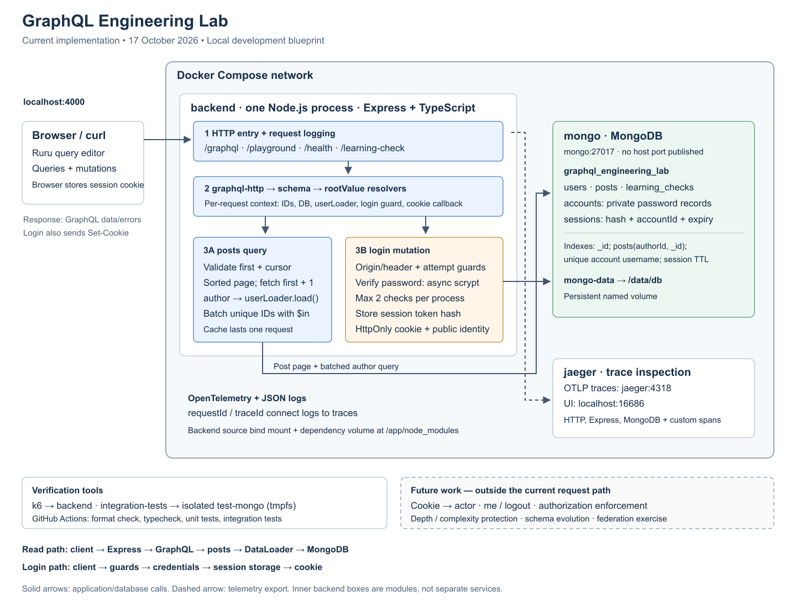
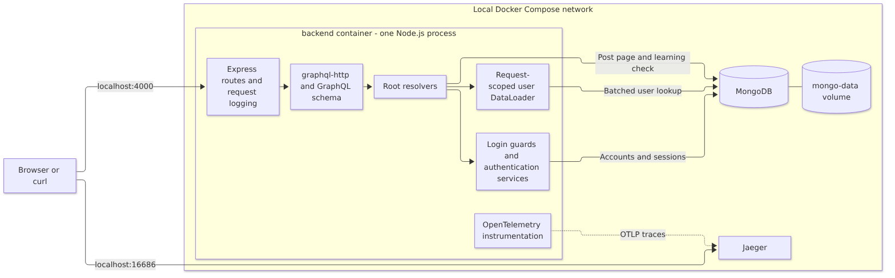
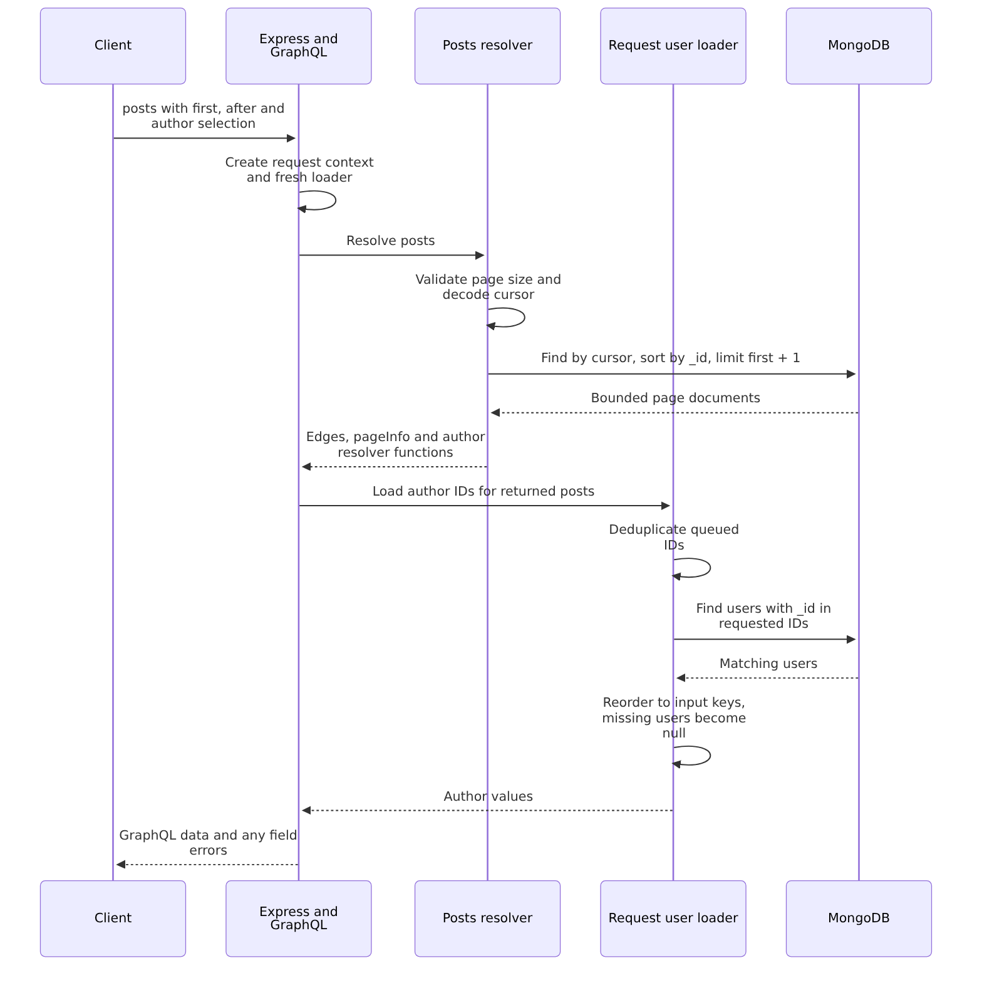
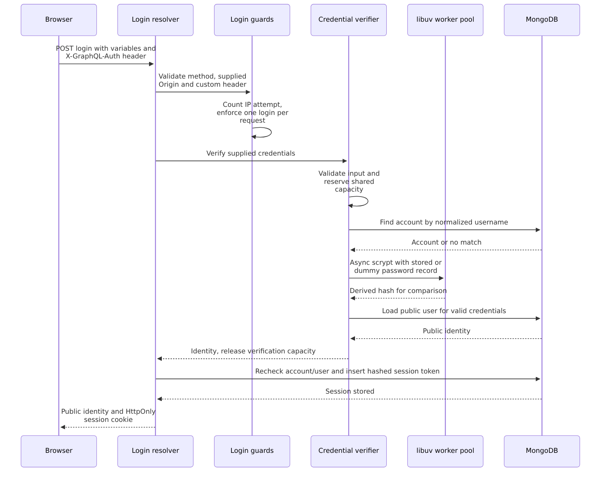
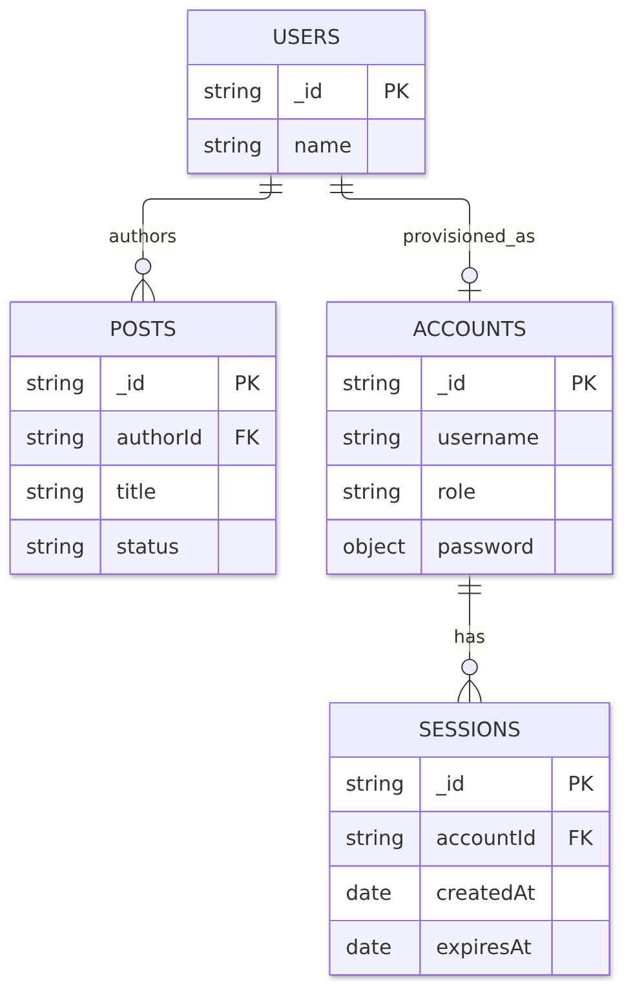
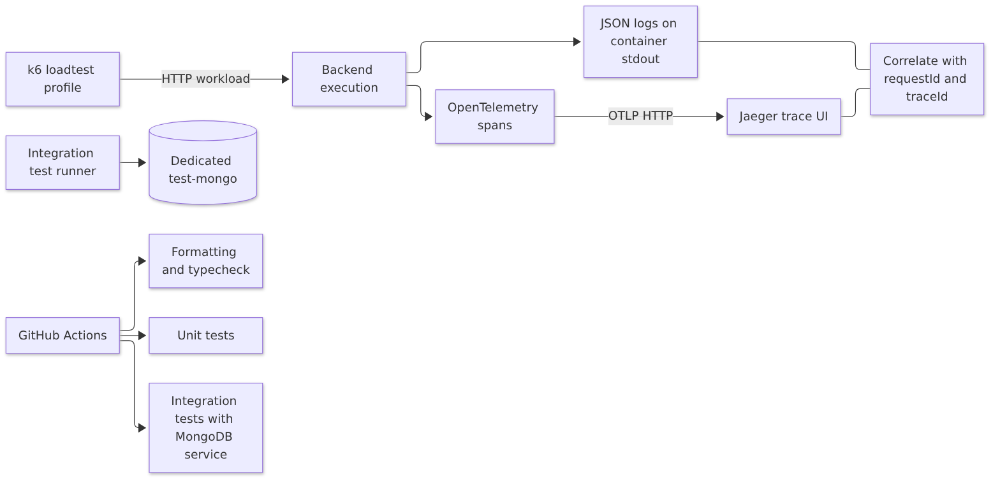

# Architecture blueprint

Snapshot: 17 October 2026. This describes the code currently in this repository, including the login checkpoint. It is a local development architecture, not a production deployment design.

All diagrams are embedded as PNG images, so no Mermaid renderer is required. The [overview SVG](diagrams/architecture.svg) stays sharp when enlarged or printed. The detailed diagrams link to their editable Mermaid sources. See [diagram rendering instructions](diagrams/README.md) to regenerate them with Docker.

For an interview-friendly progression from the whole system to its internal modules, see the [C4 architecture views](c4-architecture.md).

## Start here after a break

Read the large diagram from left to right: client, one backend process, database. Then follow one query and one login through the sequence diagrams. Dashed future-work items describe features we have not connected yet.

The application is a modular monolith: GraphQL transport, resolvers, authentication helpers, and DataLoader run inside one Express application. MongoDB stores application data; Jaeger receives traces. Having several Docker containers does not make the application a microservices system.

## Runtime components and boundaries

[Editable Mermaid source](diagrams/runtime-components.mmd)

| Component | Responsibility | Lifetime / boundary |
|---|---|---|
| Express | HTTP routes, request logging, browser cookie response | One backend process |
| graphql-http | GraphQL HTTP handling and execution using the schema and rootValue | Handler constructed for each incoming GraphQL request |
| GraphQL context | Pass database access, request ID, loader, verification function, guards and cookie callback to resolvers | One request |
| User DataLoader | Deduplicate queued author IDs, batch lookups, preserve result ordering, cache results | One request; no cross-request cache |
| Credential verifier | Normalize and validate input, check scrypt password, return public identity | Initialized at startup; reused across requests |
| Login rate limiter | 10 attempts per IP per 15-minute fixed window; at most 10,000 tracked keys | In-memory per process; resets on restart |
| Login attempt guard | At most one attempted login per GraphQL HTTP request | One request |
| Password concurrency limiter | At most two active credential checks; reject excess work without queueing | Shared within one process |
| Session service | Create, resolve and revoke server-side sessions | MongoDB-backed; resolve/revoke helpers exist but HTTP actor integration and logout are future work |
| MongoDB | Store users, posts, credentials and sessions | Separate container; persistent data volume |
| OpenTelemetry / Jaeger | Record and inspect request and database timing | Instrumentation in backend; separate trace receiver/UI |

Local application traffic enters through 127.0.0.1:4000. The backend reaches MongoDB using mongo:27017 over Compose networking. MongoDB has no published host port. Jaeger's UI is exposed on 127.0.0.1:16686; trace export stays inside the Compose network.

## Follow a posts query

[Editable Mermaid source](diagrams/posts-query.mmd)

For the tested posts-with-authors query, one posts lookup plus one author batch replaces one posts lookup plus a lookup per post. The loader runs only when author is selected. Different execution dependencies or batch scheduling can produce additional batches; two database calls is not a universal promise for arbitrary GraphQL operations.

Pagination defaults to 5 posts and permits at most 20 per field invocation. Fetching one extra document determines hasNextPage. The cursor is versioned base64url JSON containing an ID; it is an opaque API position, not encryption. The current sort order is the string _id order, not creation time.

The current posts path filters by cursor only. Although posts have a status field and an authorization policy document exists, draft visibility enforcement is not implemented. A per-field page limit also does not bound the total cost of aliases or a whole GraphQL operation.

## Follow a login mutation

[Editable Mermaid source](diagrams/login-flow.mmd)

This diagram follows a successful login. Rejected requests stop at the relevant guard; unknown usernames and incorrect passwords produce the same generic credentials error. Verification capacity is released on errors too. Database failures return a generic SERVICE_UNAVAILABLE error instead of issuing a successful login response.

- The browser receives a fresh random token in the session cookie; MongoDB stores its SHA-256 hash, accountId, creation time and expiry.
- Session lifetime is eight hours. Lookup enforces expiry independently of asynchronous TTL cleanup.
- The cookie is HttpOnly, SameSite=Lax, host-only and scoped to /. Secure is enabled when NODE_ENV is production; the current local setup uses HTTP. Successful login sets Cache-Control: no-store.
- Authentication mutations require POST and X-GraphQL-Auth: 1. A supplied Origin must exactly match AUTH_ALLOWED_ORIGIN. Non-browser clients may omit Origin but still need the custom header. The header is a request protection mechanism, not a secret or identity credential.
- Accounts and public users share an ID under the current one-account-per-user design. Password records remain in the private accounts collection; roles cannot be selected through login inputs.
- Cookie issuance is implemented. Reading incoming cookies into context.actor, Query.me and Mutation.logout are not wired yet. A browser holding a cookie therefore does not yet gain authenticated application behavior.

## Data model and persistence

[Editable Mermaid source](diagrams/data-model.mmd)

Relationships are application conventions, not MongoDB foreign-key constraints. SESSIONS._id is the token hash. learning_checks is a separate teaching collection for database connectivity and partial-failure exercises.

| Index | Purpose and limit |
|---|---|
| Default _id indexes | Current cursor-page traversal, document and token-hash lookup |
| posts(authorId, _id) | Supports the author-filter-plus-sort query studied with explain; the current public posts resolver does not filter by authorId |
| Unique accounts.username | Prevent duplicate normalized usernames |
| sessions.expiresAt TTL | Background cleanup; not immediate expiry enforcement |

mongo-data contains persistent database files. backend-dependencies is an external named volume mounted at /app/node_modules. Backend source is bind-mounted from the repository; dependency storage is separate from MongoDB data.

## Observability and verification

[Editable Mermaid source](diagrams/observability.mmd)

Automatic tracing covers HTTP, Express and MongoDB. Custom spans cover posts resolution and user batches. Logs remain on stdout; log and metric export are disabled in the current configuration. Jaeger is for traces, not a configured durable log store. Its current development setup has no persistent storage volume.

Local integration tests use a separate MongoDB service and dedicated test database, with tmpfs storage. They do not exercise the development database. The login integration tests execute the schema and actual resolver registration, verifier and session storage; they capture the cookie callback. They are not end-to-end browser/HTTP tests. Cookie attribute tests exercise the cookie helper separately.

## What is implemented versus future work

| Area | Current state |
|---|---|
| Express, TypeScript, Docker Compose, MongoDB | Implemented |
| GraphQL queries, playground, pagination and DataLoader | Implemented |
| Credentials, session helpers, guarded login and cookie issuance | Implemented; login test additions are the current checkpoint |
| Request logs, custom spans, Jaeger and k6 baseline | Implemented |
| Incoming-cookie authentication, actor context, me, logout | Future work |
| Draft visibility, object/field authorization and publication rules | Policy/data model exist; enforcement is future work |
| Query depth and operation complexity protection | Deferred / future work |
| Schema evolution exercise and federation | Future work |
| Production deployment and distributed login limits | Outside the current local blueprint |

## Interview walkthrough

### Explain the system in about one minute

> This is a Docker-based GraphQL learning application built with Express, TypeScript and MongoDB. The application is one modular backend, with resolvers and authentication helpers running in the same process. Each request gets its own context and DataLoader. For posts with authors, I use bounded cursor pagination and batch author lookups to remove the demonstrated N+1 pattern. Login uses asynchronous scrypt, a process-wide concurrency limit and per-IP attempt limits. It creates an opaque session, stores only the token hash and returns an HttpOnly cookie. I trace requests with OpenTelemetry and Jaeger and correlate them with structured logs. CI runs formatting, type checks, unit tests and MongoDB integration tests. Incoming session authentication and authorization enforcement are the next steps.

### Explain the tradeoffs when asked

- Why request-scoped DataLoader? Its cache cannot leak cached data across requests, and each request sees its own batch. Authorization-aware loading still needs appropriate access checks when authorization is implemented.
- Why pagination as well as batching? Batching reduces round trips; pagination bounds documents per selected list field. Neither replaces whole-operation abuse protection.
- Why asynchronous scrypt plus concurrency limits? Hashing is expensive. The worker pool keeps the JavaScript event loop available, while limits bound active work and associated memory use.
- Why server-side sessions? They support revocation and expiry checks against current storage. They also add database dependency to authenticated requests once integrated.
- What changes with multiple backend instances? In-memory rate and concurrency limits are per process. A distributed deployment needs a deliberate shared attempt-limit policy and capacity planning; the current constants do not become global limits.
- What has not been proven? Local load-test numbers are not production capacity guarantees. No depth/complexity protection or authorization enforcement should be claimed yet.

## Code reading map

| Question | Start in |
|---|---|
| Which containers, ports and volumes exist? | [compose.yaml](../compose.yaml) |
| Where does a request enter and get context? | [main.ts](../backend/src/main.ts) |
| Which fields exist and which functions resolve them? | [graphql.ts](../backend/src/graphql.ts), [resolvers/index.ts](../backend/src/resolvers/index.ts) |
| How do posts and author batches work? | [posts.ts](../backend/src/resolvers/posts.ts), [loaders.ts](../backend/src/loaders.ts), [pagination.ts](../backend/src/pagination.ts) |
| How does login connect the security helpers? | [login.ts](../backend/src/resolvers/login.ts), [authentication design](authentication/login.md) |
| Where do identity and sessions live? | [credentials.ts](../backend/src/auth/credentials.ts), [sessions.ts](../backend/src/auth/sessions.ts) |
| How are timing and traces captured? | [instrumentation.ts](../backend/src/instrumentation.ts), [tracing guide](tracing.md) |
| What is the intended authorization policy? | [authorization.md](authorization.md) |

Update this blueprint in the same feature PR whenever a container, request path, trust boundary or feature status changes. Keep the large diagram focused on components; place implementation detail in the sequence diagrams and linked design documents.

