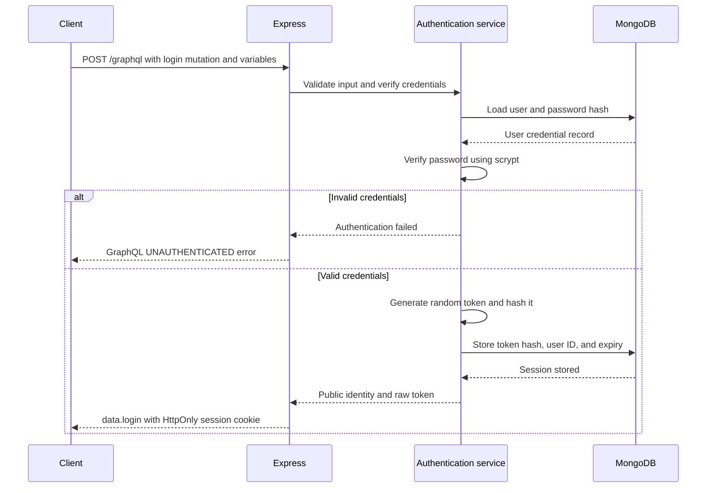
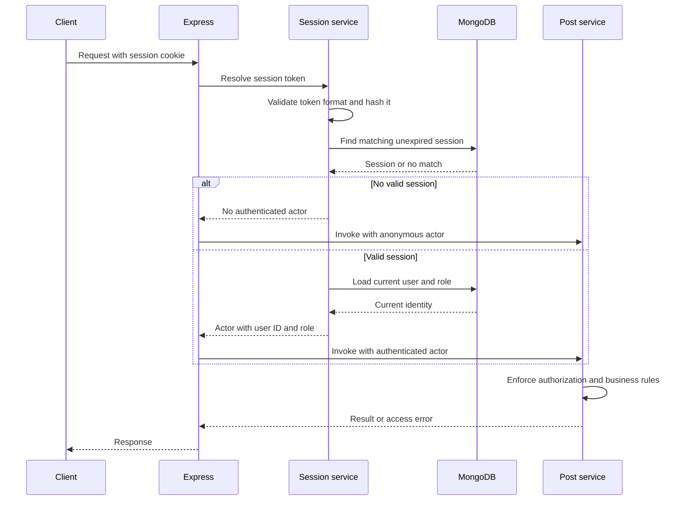
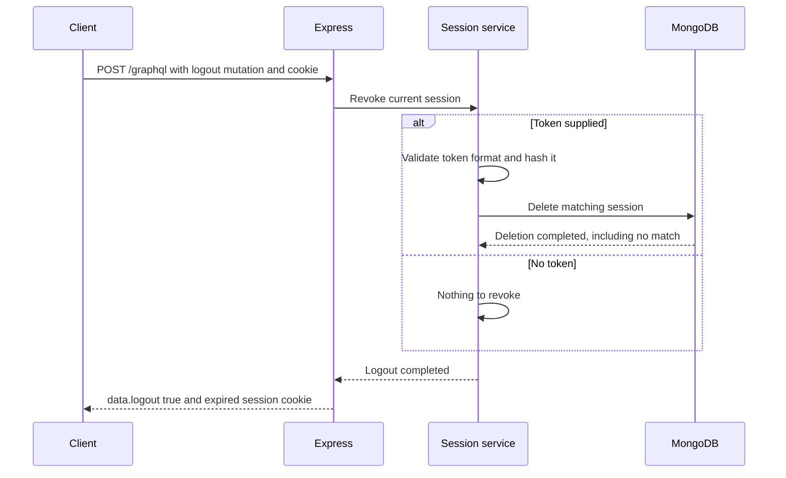

# Session authentication design

Credential provisioning and the session service are implemented and verified. Login, cookies, and request integration are planned.

## Documentation

- [GraphQL authentication design](login.md): mutations, queries, cookies, protection limits, and verification scenarios.
- [Revised login ticket](login-ticket.md): copyable description for the existing GitHub issue.

## Operations

All operations use /graphql within Express. Login is the current ticket;
me, logout, and actor integration are planned follow-ups. Resolver errors
are represented through GraphQL errors, not inferred from HTTP status alone.

- Mutation.login accepts username/password input and sets the session cookie.
- Query.me returns public identity for a valid session, or null without one.
- Mutation.logout revokes the current session and clears its cookie.
- GraphQL uses the same session service to populate context.actor.

## Credentials and provisioning

- Passwords use salted asynchronous scrypt with explicit parameters.
- Stored credentials include the salt, hash, and algorithm parameters.
- Passwords and raw session tokens must not appear in logs or traces.
- Initial users are provisioned through a Docker-run administrative command.
- Ordinary accounts receive the user role.
- Admin provisioning is an explicit administrative action.
- Public inputs cannot assign roles.
- Existing seed users remain unable to log in until provisioned.

## Sessions

- Generate a new 32-byte cryptographically random token on login.
- Store its SHA-256 hash, user ID, creation time, and expiry in MongoDB.
- Send the raw token only through the session cookie.
- Sessions expire eight hours after creation without sliding renewal.
- Multiple sessions per user are allowed.
- Logout revokes only the current session.
- Validate expiry during lookup; database cleanup is not the expiry check.
- Load the current user's role when constructing the actor.

## Cookies and browser requests

- Cookie name: session.
- HttpOnly: true.
- SameSite: Lax.
- Path: /.
- Omit Domain to keep the cookie host-only.
- Local HTTP development uses Secure: false.
- Production requires HTTPS and Secure: true.
- Cookie lifetime matches session expiry.
- Clearing the cookie uses the same name, path, and domain scope.
- State-changing browser requests require CSRF protection.
- SameSite alone is not the complete CSRF policy.
- Credentialed browser access is restricted to the configured application origin.

## Failure behavior

- Invalid login credentials return the same generic UNAUTHENTICATED GraphQL error.
- No cookie, an invalid token, an expired session, or a revoked session
  produces no authenticated actor.
- Query.me returns null when no authenticated actor exists.
- Authentication-storage failure returns a generic service-unavailable
  error; it must not silently downgrade a session-bearing request to anonymous.
- Missing or already revoked sessions can be logged out idempotently.
- A database failure must not be reported as successful session revocation.
- Authorization remains the responsibility of post services.

## Account identity

The private account record shares its _id with the public user record.
This expresses our one-account-per-user relationship and lets MongoDB's
unique _id prevent duplicate accounts for the same user.

Account identity is not independent in the current design.
A separate account ID can be introduced if that requirement changes.

## Account provisioning

Ensure indexes exist:

    docker compose exec backend npm run db:indexes

Provision an existing public user:

    docker compose exec backend npm run account:provision -- \
      --user-id user-1 --username ada

Passwords are entered through hidden prompts, not command arguments.
New accounts default to the user role. The administrative command
requires --admin to provision an admin.

Provisioning never overwrites an existing account.

## Session service

- Generates opaque tokens from 32 cryptographically random bytes.
- Stores only the token hash, account reference, and timestamps.
- Enforces an eight-hour absolute expiry during lookup.
- Reads the current account role and requires an existing public user.
- Revokes only the supplied session; repeated revocation is safe.
- Uses a TTL index for background cleanup, independent of expiry enforcement.
- Propagates database failures instead of treating them as anonymous access.

### Verified behavior

- Correct passwords verify; incorrect passwords fail.
- Fresh hashes use different salts.
- Malformed credential records and unsupported parameters are rejected.
- Usernames are normalized and validated.
- Duplicate provisioning preserves the original password and role.
- A normalized username cannot belong to another account.
- Missing public users cannot receive accounts.
- Ordinary provisioning defaults to user.
- Explicit --admin provisioning creates an admin account.
- Verification output excludes stored credentials.
- Integration tests cover session creation, hashed storage, expiry,
  independent sessions, repeated revocation, current roles, missing users,
  missing accounts, and database-access failure propagation.
- Unit and integration tests run in separate CI jobs.
  Integration tests use a dedicated MongoDB service and database.

GraphQL authentication operations and session cookies are not yet implemented.

## Authentication flow

### Login

The raw token is sent in the cookie, not the response body.
No successful login is reported unless session storage succeeds.

### Authenticated request

GraphQL receives the actor through request context.
Protected operations reject anonymous actors.

If session storage is unavailable, return a service-unavailable error
instead of treating a session-bearing request as anonymous.

### Logout

Logout is idempotent when the session is missing or already revoked.
A storage failure returns a service-unavailable error rather than
reporting successful revocation.

## Verification scenarios

| Scenario | Expected |
|---|---|
| Correct username and password | data.login, session stored, cookie set |
| Incorrect password | Generic UNAUTHENTICATED error; no session created |
| Unknown username | Same generic UNAUTHENTICATED error; no session created |
| Malformed login input | GraphQL validation or BAD_USER_INPUT error; no session created |
| Login when session storage fails | SERVICE_UNAVAILABLE error; no authenticated session issued |
| Query.me with valid session | Public identity |
| Query.me without cookie | null |
| Query.me with malformed, unknown, expired, or revoked token | null |
| Query.me with a session referencing a deleted user | null |
| User role changes after login | Next request uses the current role |
| Authentication storage unavailable | SERVICE_UNAVAILABLE error; no anonymous fallback |
| Logout with valid session | true; session revoked and cookie cleared |
| Logout with no session or an already revoked session | true; cookie cleared |
| Logout when revocation storage fails | SERVICE_UNAVAILABLE error; revocation not reported as successful |
| Two sessions exist and one logs out | Other session remains valid |
| Disallowed browser origin on a state-changing request | Rejected before state changes |
| Inspect logs, traces, and public responses | No password, password hash, or raw session token exposed |

Cookie attributes must be verified separately in local development
and production configuration.

A valid session establishes identity but does not bypass post
authorization or publication business rules.

