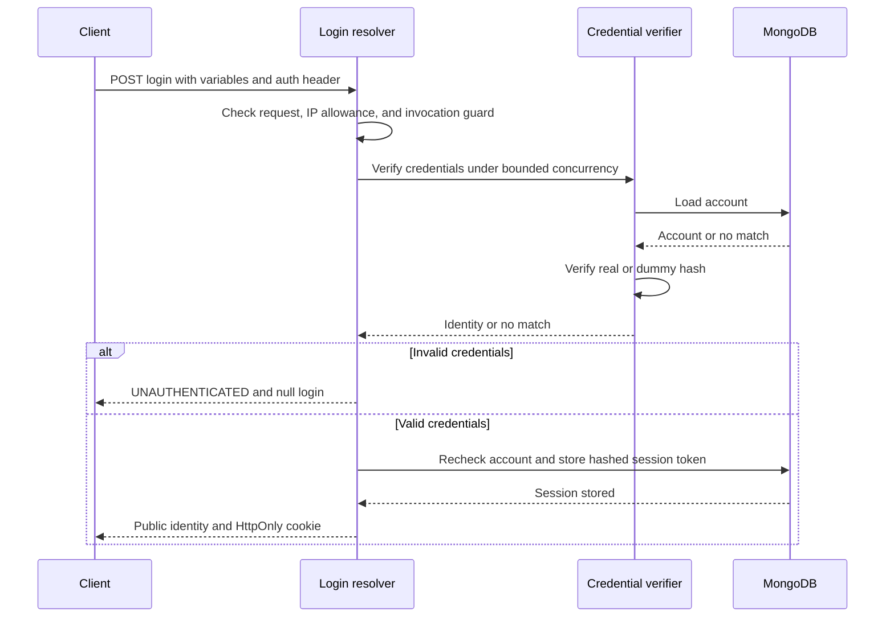
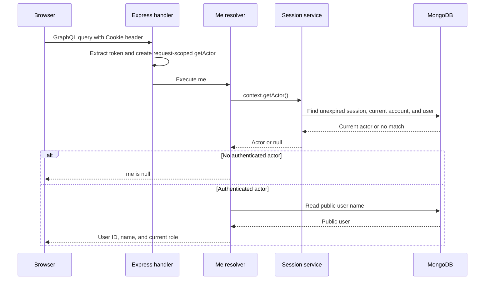
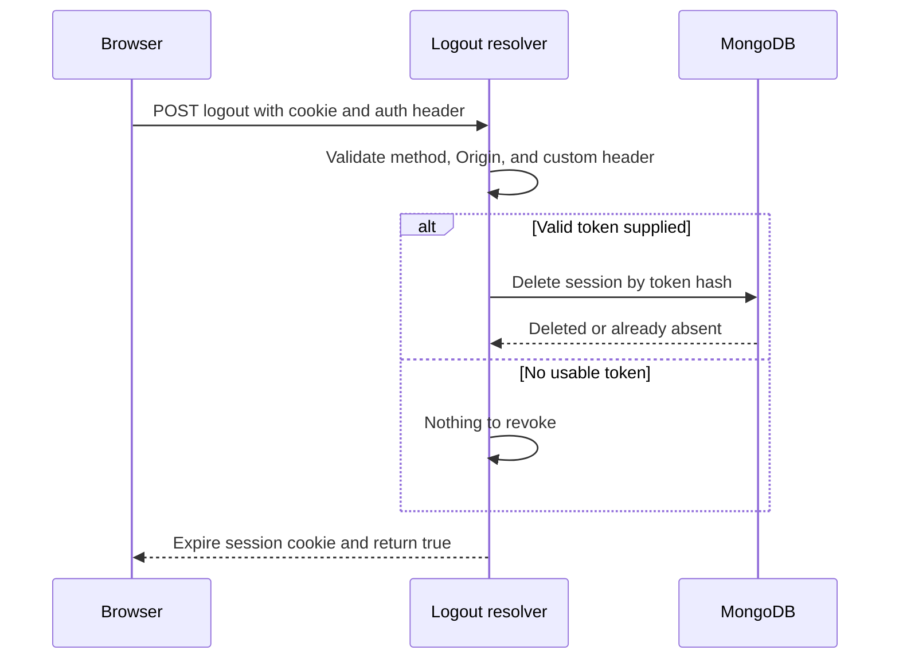

# Session authentication

Login, incoming session authentication, `Query.me`, and logout are implemented.
The browser login/me/logout flow has been manually verified. Automated coverage
is described below; run the checks before merging a checkpoint.

## Documentation

- [GraphQL authentication contract](login.md): schema, operations, protections,
  errors, implementation map, and remaining work.
- [Authorization design](../authorization.md): post permissions and business rules.
  Establishing identity does not implement those permissions.

## Operations

All authentication operations use `/graphql` inside Express.

| Operation | Responsibility | Anonymous behavior |
| --- | --- | --- |
| `Mutation.login` | Verify credentials, store a session, set its cookie | Accept valid provisioned credentials |
| `Query.me` | Resolve the incoming session and return public identity | Return `null` |
| `Mutation.logout` | Revoke the incoming session and clear its cookie | Succeed when the session is missing |

Login and logout require POST and `X-GraphQL-Auth: 1`. If an Origin header is
present, it must exactly match `AUTH_ALLOWED_ORIGIN`. Requests without Origin
are allowed only with the required method and custom header. The header is a
CSRF protection layer, not an authentication secret. Separate-origin browser
clients and credentialed CORS are not configured by this design.

GraphQL execution errors use `errors[].extensions.code`; HTTP 200 alone does
not establish success. `/graphql` responses use `Cache-Control: no-store`.

## Account identity and provisioning

The private account shares its `_id` with the public user. This represents one
account per user; the unique `_id` prevents multiple accounts for that user.
The account stores username, password record, and role. The public user stores
profile data. Provisioning requires an existing public user and never overwrites
an existing account.

```bash
docker compose exec backend npm run db:indexes

docker compose exec backend npm run account:provision -- \
  --user-id user-1 --username ada
```

Passwords are entered through hidden prompts, not command arguments. Accounts
default to `user`; `--admin` explicitly provisions an admin. Existing seeded
users cannot log in until provisioned. Public GraphQL inputs cannot assign roles.

## Passwords and login protections

- Salted asynchronous scrypt hashes preserve password whitespace exactly.
- Password policy: 15-128 Unicode code points, at most 1024 UTF-8 bytes.
- Usernames are normalized and validated.
- Unknown usernames use a precomputed dummy password hash and receive the same
  generic credentials error as an incorrect password.
- Two password verifications can be active per backend process; excess work is
  rejected without a waiting queue.
- A shared limiter allows ten login attempts per IP per 15-minute fixed window.
- Rate-limit storage holds at most 10,000 keys. Expired entries are reclaimed
  when needed; new keys are rejected if capacity remains exhausted.
- After request validation, successful and unsuccessful invocations count toward
  the IP allowance, including additional login aliases.
- Only one login attempt is allowed per HTTP request.

IP addresses come from Express `req.ip` with its default `trust proxy: false`.
Docker networking may cause clients to share an address. In-memory attempt counts
reset on restart and are not shared across replicas.

## Session lifecycle

- Login generates a random 32-byte token, encoded as 64 lowercase hex characters.
- MongoDB stores only its SHA-256 hash, account reference, creation time, and expiry.
- The raw token is sent through the cookie, never a GraphQL response field.
- Sessions expire after eight hours without sliding renewal.
- Lookup enforces expiry even if the TTL cleanup has not removed the document.
- Multiple sessions per account are allowed; logout revokes only the supplied one.
- Each lookup checks the current account role and requires a public user.

## Cookies

| Setting | Value |
| --- | --- |
| Name | `session` |
| HttpOnly | `true` |
| SameSite | `Lax` |
| Path | `/` |
| Domain | Omitted; host-only cookie |
| Secure | `true` when `NODE_ENV=production`; otherwise `false` |
| Expiry | Matches the stored session expiry |

Production requires HTTPS. Clearing uses the same cookie scope, an empty value,
and an expiry in the past. SameSite is one layer of browser protection, alongside
the method, Origin, and custom-header checks.

Incoming cookie extraction accepts only the raw token format this application
issues. Missing, malformed, encoded, quoted, or duplicate session cookies produce
no token. Unrelated cookies are ignored.

## Login flow



The password verification slot is released in `finally`. Session creation follows
verification. Session storage failure produces a generic error and no new cookie.

## Incoming request and me



Missing or malformed tokens return `null` before database lookup. `getActor()` is
lazy: operations that never call it perform no session lookup. Within one request,
it reuses the same Promise, including anonymous results and failures. A new request
gets a new lookup and therefore sees subsequent role changes.

Authentication storage failure returns `SERVICE_UNAVAILABLE` at the calling field;
it does not silently treat the caller as anonymous. `me` makes an additional public
user lookup for the name and returns `null` if that user has disappeared.

Identity is available through `context.getActor()`, not a `context.actor` property.
Post authorization is separate work; existing post resolvers do not automatically
become protected because authentication exists.

## Logout flow



Logout does not require actor lookup or consume login attempts. Missing, malformed,
expired, and already revoked sessions can be logged out idempotently. A storage
failure returns `SERVICE_UNAVAILABLE` and does not clear the cookie or claim success.
It does not revoke the account's other sessions.

## Verification

| Test file | Coverage |
| --- | --- |
| `src/auth/session-cookie.test.ts` | Token extraction, malformed values, duplicate cookies |
| `src/auth/request-actor.test.ts` | Lazy lookup, request isolation, shared Promise, sanitized failures |
| `src/auth/cookies.test.ts` | Setting and clearing cookies in development and production configuration |
| `tests/integration/login.test.ts` | Login results, session storage, invalid credentials, aliases, rate and capacity errors, storage failure |
| `tests/integration/me.test.ts` | Valid and invalid sessions, expiry, revocation, current roles, deleted identities, storage failure |
| `tests/integration/logout.test.ts` | Current-session revocation, independent sessions, idempotency, request rejection, storage failure |
| `tests/integration/sessions.test.ts` | Session storage, expiry enforcement, current identity, revocation |

Resolver integration tests execute the schema with request-context fixtures and an
isolated MongoDB database. Cookie tests use a temporary Express HTTP server. The
manual playground flow checks the browser sending and clearing its cookie.
These are distinct checks; resolver tests do not exercise the full Express route.

```bash
docker compose exec backend npm run format:check
docker compose exec backend npm run typecheck
docker compose exec backend npm test
docker compose --profile test run --rm integration-tests
```

Unit and integration tests run in separate CI jobs. Keep commits small and record
actual verification results before merging.

## Remaining work

- Enforce post authorization and business rules through services.
- Implement and verify the proposed 64 KiB GraphQL body cap; it is not currently enforced explicitly by the application.
- Audit logs and instrumentation for passwords, credential records, raw tokens,
  Cookie/Set-Cookie headers, and credential-bearing GraphQL documents or variables.
- Define and test combinations of login and logout in one mutation operation.
  The current token and cached actor reflect the incoming request; cookie writes
  do not refresh them within that operation.
- [Query depth validation](../query-depth.md) is implemented under ticket #32. Authentication limits
  do not provide general query complexity or width protection.

