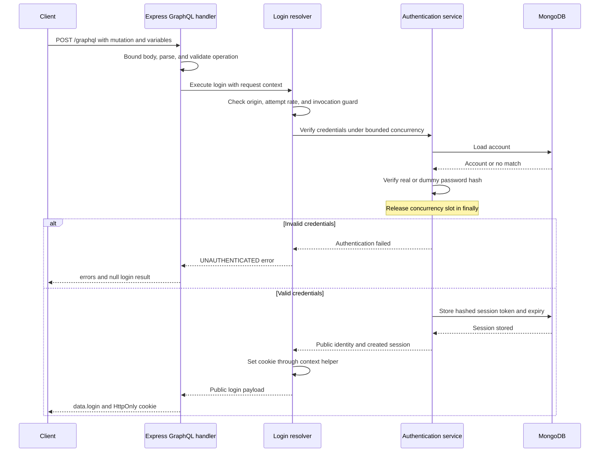

# GraphQL authentication design

Status: planned. Password provisioning and the session service are already
verified; GraphQL login, cookies, and request integration are not implemented.

See [the authentication overview](README.md) for the session lifecycle.

## Transport and responsibilities

Authentication uses the existing POST /graphql endpoint inside Express.
No REST authentication endpoints are planned.

- Mutation.login verifies credentials, creates a session, and sets its cookie.
- Query.me resolves the cookie to the current public identity.
- Mutation.logout revokes the current session and clears its cookie.

This ticket implements login. The me query, logout mutation, and general
actor integration remain follow-up tickets. They are shown here to describe
the complete target API.

Resolvers call transport-independent authentication services. Cookie helpers
are supplied through request context; services do not depend on Express.

## Target schema

Add these definitions to the existing schema; retain existing query fields.

```graphql
enum AccountRole {
  USER
  ADMIN
}

input LoginInput {
  username: String!
  password: String!
}

type AuthUser {
  id: ID!
  name: String!
  role: AccountRole!
}

type LoginPayload {
  user: AuthUser!
}

extend type Query {
  me: AuthUser
}

type Mutation {
  login(input: LoginInput!): LoginPayload
  logout: Boolean
}
```

login and logout results are nullable so a field failure can be represented
by null plus an error path. GraphQL operations are not database transactions:
one successful mutation is not rolled back if another field fails.

Stored roles remain user/admin. Map them explicitly to USER/ADMIN in the API.

## Login operation and variables

```graphql
mutation Login($input: LoginInput!) {
  login(input: $input) {
    user {
      id
      name
      role
    }
  }
}
```

Example variables, not actual credentials:

```json
{
  "input": {
    "username": "ada",
    "password": "example only; never log actual credentials"
  }
}
```

Clients should use variables. Credentials supplied as literals are still
sensitive: logging the operation document can expose them too.

Normalize usernames, but preserve passwords exactly. Apply the existing
password limits: 15–128 Unicode code points and at most 1024 UTF-8 bytes.
GraphQL input validation rejects unknown fields, including role and userId.

## Successful result and cookie

```json
{
  "data": {
    "login": {
      "user": {
        "id": "user-1",
        "name": "Ada",
        "role": "USER"
      }
    }
  }
}
```

Set the raw session token in Set-Cookie only after session storage succeeds.
Never return the token or credential record as a GraphQL field.

## Error contract

Execution errors use errors[].extensions.code and identify the failing field
through errors[].path. HTTP 200 alone does not indicate GraphQL success.
Parsing, validation, media-type, and request-size failures happen at the
transport/validation layer and can have different HTTP statuses.

| Situation | Application error code | Behavior |
|---|---|---|
| Unknown username or incorrect password | UNAUTHENTICATED | Same message: Invalid username or password |
| Invalid credential input | BAD_USER_INPUT | No password check or session creation |
| Disallowed browser origin | FORBIDDEN | No authentication state change |
| Login attempt rate exceeded | TOO_MANY_REQUESTS | No password check; retry guidance |
| Password-check capacity exhausted | SERVICE_UNAVAILABLE | No waiting queue; retry guidance |
| Account lookup, hashing, or session storage fails | SERVICE_UNAVAILABLE | Generic error; no successful login |
| Additional login invocation in one request | BAD_USER_INPUT | No additional session or password check |

Example execution failure:

```json
{
  "errors": [
    {
      "message": "Invalid username or password",
      "path": ["login"],
      "extensions": { "code": "UNAUTHENTICATED" }
    }
  ],
  "data": { "login": null }
}
```

## Request context

The planned context supplies narrow helpers such as setSessionCookie and
clearSessionCookie, backed by the current Express response.

It also supplies database access, request/trace IDs, and trusted request
metadata for origin and IP checks. Clients cannot choose this metadata.
Actor lookup will be added separately through the shared session service.

## Initial resource limits

| Control | Initial policy |
|---|---|
| GraphQL JSON body size | Maximum 64 KiB |
| Password-check concurrency | Two active checks per backend process |
| Password-check waiting queue | None; reject excess work |
| Login attempt rate | Ten resolver attempts per IP per 15 minutes |
| Attempts counted | Successful and unsuccessful login invocations |
| Session lifetime | Eight hours, without sliding renewal |

The body cap applies to all /graphql operations, not only login. It replaces
the previously proposed 4 KiB REST-login cap. Verify playground introspection
and existing publishing operations fit before adopting it.

These are conservative learning defaults, not measured production limits.
Two active hashes require approximately 256 MiB plus application overhead.

Acquire the concurrency slot before account lookup and real/dummy password
verification. Release it in finally. Session creation follows verification.

Rate-limit storage and proxy/IP trust must be defined before implementation
is complete. Per-process controls are not global across replicas.
Depth validation remains deferred under ticket #32; this body cap does not
substitute for depth, complexity, or query-width controls.

## Aliases and mutation execution

Top-level mutation fields execute serially, but aliases can invoke login
multiple times in one HTTP request. Rate limiting must count resolver attempts,
not merely HTTP requests.

For the initial implementation, a request-scoped guard allows at most one
login invocation. Additional invocations fail before password verification
or session creation. They still count as login attempts for the rate policy.

A first successful login is not rolled back if a later alias fails. Its cookie
and stored session remain. Future combinations of login and logout require an
explicit policy and tests when logout is introduced.

## Login flow



Storage or hashing failures return a generic service-unavailable error.
A failed invocation does not issue a new session cookie.

## Unknown-user handling

Precompute a dummy password record using the same supported scrypt settings.
Unknown usernames verify against it instead of skipping expensive work.
Both unknown usernames and incorrect passwords receive the same error message.
Dummy verification reduces one timing difference; it does not make the entire
request constant-time.

## Cookies and browser protection

- session cookie: HttpOnly, SameSite=Lax, Path=/, no Domain.
- Local HTTP: Secure=false. Production: HTTPS and Secure=true.
- Cookie lifetime matches session expiry.
- Protect login and other cookie-based mutations against CSRF.
- Define an exact allowed browser origin and missing-Origin policy for CLI tools.
- Reject mutations over GET; GET queries must not create or revoke sessions.
- Define CORS/preflight policy if separate browser origins are supported.
- SameSite alone is not the complete CSRF protection.

## Sensitive-data handling

Do not log or trace passwords, credential records, raw session tokens, Cookie
headers, Set-Cookie headers, request variables, or authentication documents
containing credential literals.

Audit HTTP, MongoDB, and any future GraphQL instrumentation for sensitive
attributes. Request/trace IDs and credential-free operation names may be logged.

## Verification scenarios

| Scenario | Expected |
|---|---|
| Correct provisioned credentials | Public login payload, stored session, cookie set |
| Incorrect password | UNAUTHENTICATED; no session created |
| Unknown username | Same error; dummy verification performed |
| Invalid GraphQL input shape | Validation rejection before resolver execution |
| Invalid username/password policy | BAD_USER_INPUT; no session created |
| Oversized GraphQL JSON | HTTP 413 before credential processing |
| Disallowed browser origin | Rejected before authentication state changes |
| Attempt rate exceeded | TOO_MANY_REQUESTS; no password check |
| Both password slots occupied | SERVICE_UNAVAILABLE for excess work |
| Verification throws or rejects credentials | Slot released |
| Storage failure | Generic SERVICE_UNAVAILABLE; no successful login |
| Multiple login aliases | Additional invocation rejected; attempt policy enforced |
| Login invoked through fragments | Same protection as a direct invocation |
| Mutation sent through GET | Rejected; no session created |
| Successful login | No credential fields in the result |
| Log and trace inspection | No credentials, tokens, or cookie headers exposed |
| Existing queries and introspection | Continue to work under the body cap |

## Implementation checkpoints

1. Add the login schema and context cookie interface.
2. Implement and unit-test the concurrency limiter.
3. Implement credential verification and dummy-record handling.
4. Add origin, rate, and request-scoped invocation protections.
5. Wire the resolver, bounded transport input, and cookie response.
6. Verify results, errors, alias/fragment behavior, and sensitive-data handling.
7. Record verification and complete CI checks.

Make small commits after verified checkpoints. me, logout, and general actor
integration remain separate follow-up tickets.
