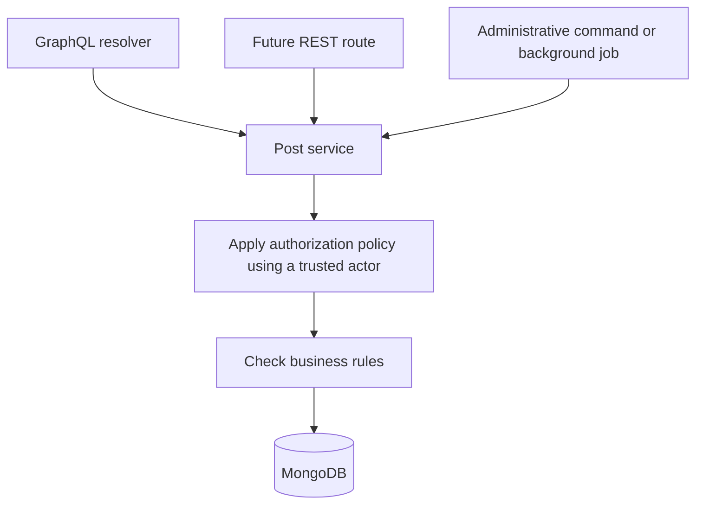
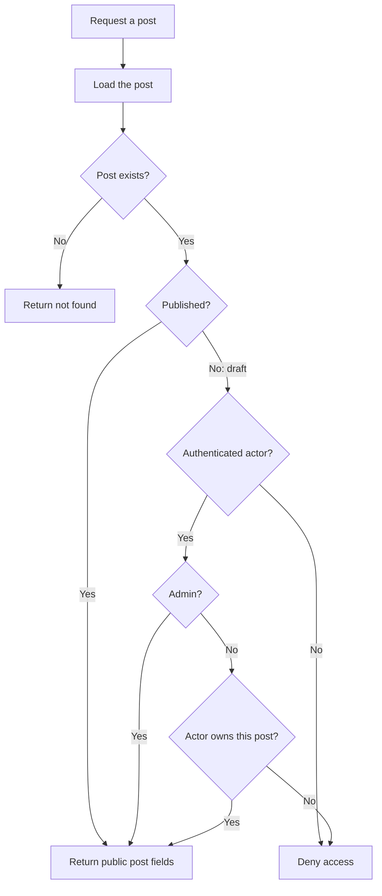
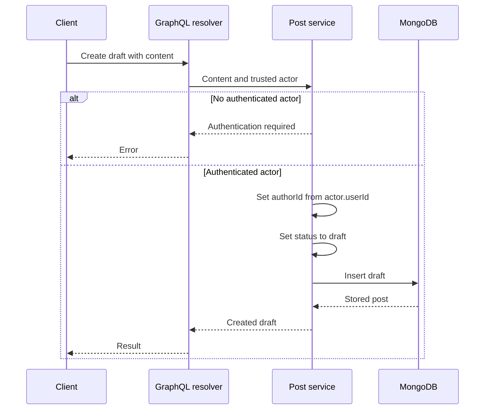
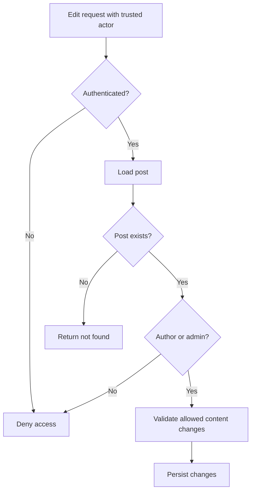
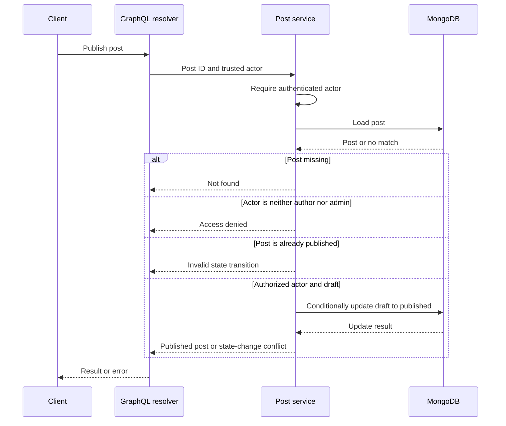
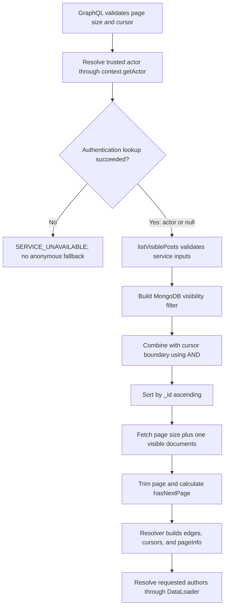

# Authorization design

Session authentication and post-list visibility are implemented. The `posts`
query now delegates to a service that applies authorization before pagination.
Service and GraphQL integration tests have passed for this checkpoint.

Single-post lookup, draft creation, editing, and publication remain planned.
The permission matrix describes the complete intended policy; the status table
below distinguishes implemented behavior from future work.

## Implementation status

| Capability | Status |
| --- | --- |
| Session identity through `context.getActor()` | Implemented |
| Published-only lists for anonymous visitors | Implemented and tested |
| Published posts plus own drafts for ordinary users | Implemented and tested |
| All posts for admins | Implemented and tested |
| Visibility filtering before cursor pagination | Implemented and tested |
| Authentication-storage failure without anonymous fallback | Implemented and tested |
| Single-post lookup | Planned |
| Draft creation, editing, and publication | Planned |

See [session authentication](authentication/README.md) for the identity lifecycle.

## Identity and post status

- An actor is an authenticated user with a user ID and a role:
  user or admin.
- Anonymous requests have no actor.
- "Post author" means the authenticated user whose ID matches
  the post's authorId. It is a relationship, not a global role.
- Posts have a status of draft or published.
- Existing seed posts have been marked published.

## Permissions

| Action | Anonymous | Signed-in non-author | Post author | Admin |
|---|---|---|---|---|
| Read published posts | Allowed | Allowed | Allowed | Allowed |
| Read a draft | Denied | Denied | Allowed | Allowed |
| Create a draft | Denied | Allowed | Allowed | Allowed |
| Edit a post | Denied | Denied | Allowed | Allowed |
| Publish a draft | Denied | Denied | Allowed | Allowed |

Creating a draft assigns the authenticated actor as its author.
Clients cannot choose another author through this operation.

Publishing requires the post to currently be a draft, including
when the actor is an admin.

## Responsibility boundaries

| Responsibility | Question | Example |
|---|---|---|
| Authentication | Who is making this request? | Resolve a session to Grace |
| Object authorization | May this actor access this post? | Grace owns this draft |
| Business rules | Is the requested action valid now? | Only a draft can be published |

A valid session establishes identity. It does not grant access
to every post.

### Enforcement location



The current post-list service enforces read visibility. Future write services will also enforce object authorization and business rules.
GraphQL resolvers obtain a trusted actor from request context and
pass it to those services.

Future REST routes, administrative commands, and background jobs
must use the same services with an explicitly established identity.
Calling from an internal entry point does not automatically grant access.

GraphQL arguments cannot establish or override the actor's identity.

## Reading a single post (planned)



Published posts are publicly readable.
Drafts are readable only by their author or an admin.

The client-visible response for an inaccessible private post will
be chosen during implementation to avoid exposing its existence.

## Creating a draft (planned)



Both ordinary users and admins create drafts under their own identity.
Assigning a draft to another author is outside the initial scope.

## Editing a post (planned)



Authors and admins may edit draft or published posts.

Editing content must not implicitly transfer ownership, change roles,
or publish a draft. Publication is a separate operation.

## Publishing a draft (planned)



Authorization and state validation are separate checks.
An admin can pass authorization and still fail the business rule.

The write must enforce the expected state so concurrent requests
cannot both claim the same successful publication transition.
Implementation will also address authorization changes between
reading and writing.

## Listing posts with pagination (implemented)



### Visibility filters

| Actor | MongoDB filter |
| --- | --- |
| Anonymous | `{ status: "published" }` |
| Ordinary user | `{ $or: [{ status: "published" }, { status: "draft", authorId: actor.userId }] }` |
| Admin | `{}` |

The actor comes from the session, never a GraphQL argument. An ordinary user's
ownership is checked against the stored `authorId`. Anonymous users also exclude
records without a recognized published status.

When a cursor exists, the query combines the visibility filter with
`{ _id: { $gt: afterId } }` using `$and`. Sorting and limiting operate on the
visible set. A cursor is a position, not proof that the caller may read the post
at that position; guessing a draft's ID does not grant access to it.

### Service contract and boundaries

```typescript
listVisiblePosts(database, actor, { pageSize, afterId }, logDatabaseCall?)
// Promise<{ posts: PostDocument[]; hasNextPage: boolean }>
```

The service accepts a trusted `Actor | null` and decoded pagination values.
It independently validates an integer page size from 1 to 20 and an `afterId`
that is either null or a nonempty string of at most 256 characters. This protects
bounds even when another entry point calls it without GraphQL validation.

The service has no dependency on GraphQL, Express, cookies, or request context.
Database errors propagate to its caller. GraphQL validates and decodes the public
arguments, resolves identity, maps service results to API objects, and converts
post database failures into generic `SERVICE_UNAVAILABLE` errors.

Authentication lookup occurs outside the resolver's post-database error handler.
An authentication failure therefore preserves its existing error instead of
falling back to anonymous visibility. Since `Query.posts` is non-null, an execution
error there propagates to root `data: null`, with an error path of `["posts"]`.

Author resolution still uses the request-scoped DataLoader, and the `graphql.posts`
span still wraps the resolver. Authenticated requests now perform session identity
lookups in addition to the post query and author batch.

### Pagination example

For an anonymous caller, consider this stored order:

| ID | Status | Visible? |
| --- | --- | --- |
| post-01 | Published | Yes |
| post-02 | Draft | No |
| post-03 | Draft | No |
| post-04 | Published | Yes |
| post-05 | Draft | No |
| post-06 | Draft | No |

With `first: 2`, the result is `post-01` and `post-04`, with `hasNextPage: false`.
The drafts neither consume page slots nor imply an additional visible page.
Filtering after the limit would produce short pages or misleading metadata.

The public connection contract is unchanged: each edge has an encoded cursor,
`endCursor` comes from the last returned edge, and an empty page has a null
`endCursor`. The service fetches one extra visible document solely to determine
`hasNextPage`, then returns the requested number of posts.

### Implementation map

Paths are relative to `backend/`.

| File | Responsibility |
| --- | --- |
| `src/posts/visibility.ts` | Build actor-dependent visibility filters |
| `src/posts/service.ts` | Validate service bounds, apply visibility and cursor, sort, fetch, trim |
| `src/resolvers/posts.ts` | Validate GraphQL arguments, get actor, call service, map connection, resolve authors, trace |
| `src/auth/request-actor.ts` | Lazy identity lookup shared within one request |
| `tests/integration/post-visibility.test.ts` | Direct-service and GraphQL authorization/pagination coverage |

## Field exposure

Document access does not mean every stored field is public.

Resolvers must return explicitly selected API fields.
Password hashes, session data, and other internal credentials
must never be exposed through user or post results.

## Verified post-list scenarios

The service tests call `listVisiblePosts` directly with trusted actors. GraphQL
tests execute the real schema and registered resolvers with cookie extraction,
session resolution, and request-scoped DataLoader helpers. They verify the resolver
path, rather than the complete Express HTTP transport.

| Scenario | Verified result |
| --- | --- |
| Anonymous caller lists mixed published posts and drafts | Published posts only |
| Ada or Grace lists posts | Published posts and only that user's drafts |
| Admin lists posts | All posts |
| Hidden drafts lie between published posts | They do not consume visible page slots |
| Only hidden drafts remain after the page | hasNextPage is false |
| An author paginates across visible pages | Stable order, correct cursors, no skipped visible records |
| Anonymous caller uses a draft ID as cursor boundary | Only subsequent visible posts are returned |
| Cursor follows the last visible post | Empty page; no next page |
| Direct service caller supplies invalid page size or boundary | Rejected |
| GraphQL requests authors on visible posts | Correct author names through DataLoader |
| Session authentication storage fails | SERVICE_UNAVAILABLE; no published-only fallback |

Fixtures use interleaved published posts and drafts in a uniquely named database
under the guarded integration-test namespace. Cleanup drops only that test's
owned database. Its name stays within MongoDB's database-name limit.

```bash
docker compose exec backend npm run format:check
docker compose exec backend npm run typecheck
docker compose exec backend npm test
docker compose --profile test run --rm integration-tests
```

Make small commits after verified checkpoints. Check the final CI results before
merging; a local verification result does not itself confirm CI success.

## Planned authorization scenarios

These define subsequent work, not implemented write or single-post endpoints.

| Scenario | Expected |
| --- | --- |
| Anonymous visitor requests a published post by ID | Allowed |
| Anonymous visitor or non-author requests a draft by ID | Inaccessible; response contract to be defined |
| Author or admin requests a draft by ID | Allowed |
| Anonymous visitor creates a draft | Denied |
| Ada creates a draft | Allowed; author is Ada |
| Ada edits Grace's post | Denied |
| Grace edits her own post | Allowed |
| Admin edits Grace's post | Allowed |
| Grace publishes her own draft | Allowed |
| Ada publishes Grace's draft | Denied |
| Admin publishes Grace's draft | Allowed |
| Author or admin publishes an already published post | Rejected by business rule |
| Future entry point invokes a post service | Same policy enforced using explicitly established identity |
