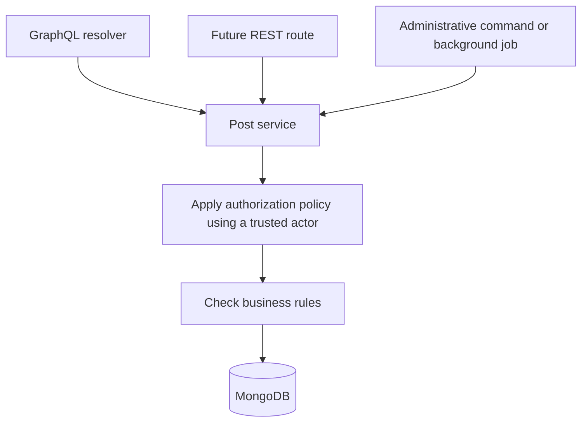
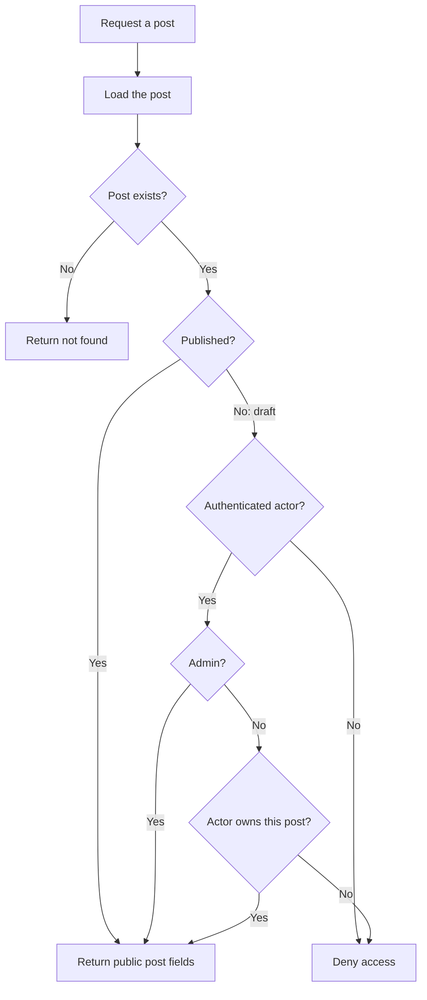
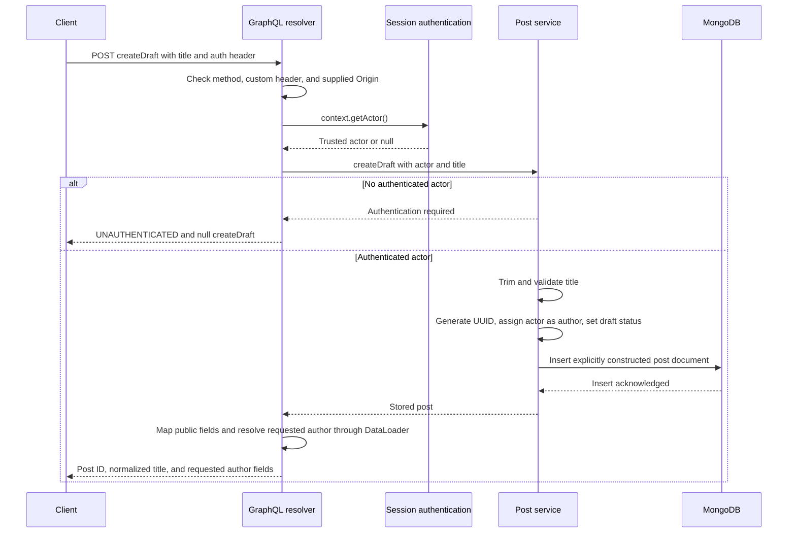
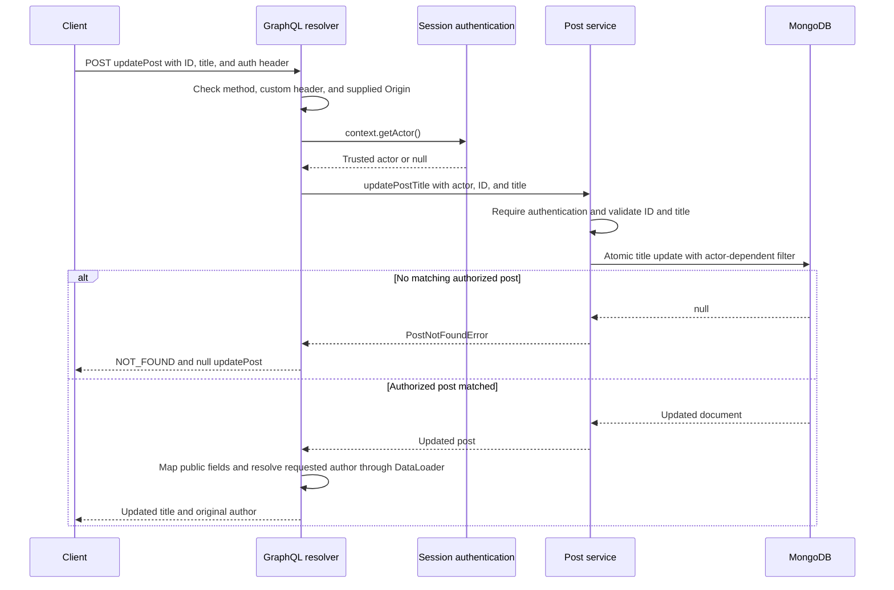
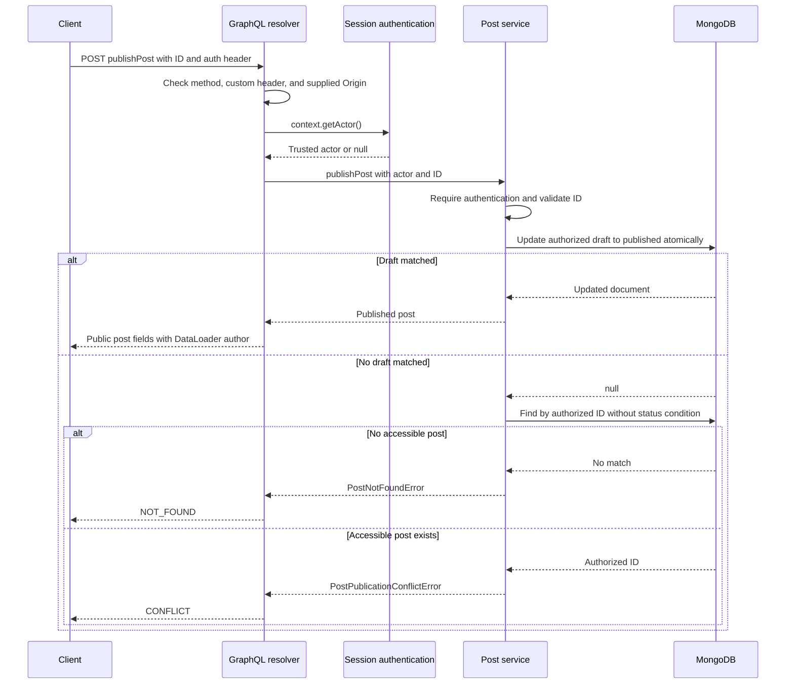
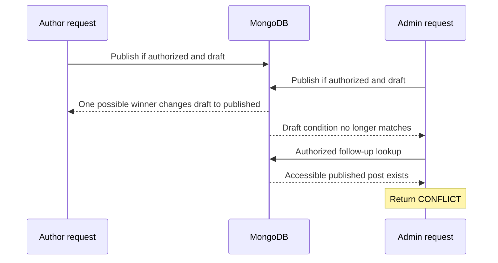
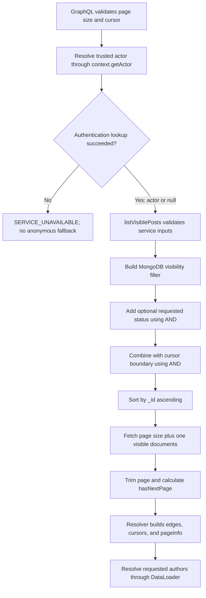
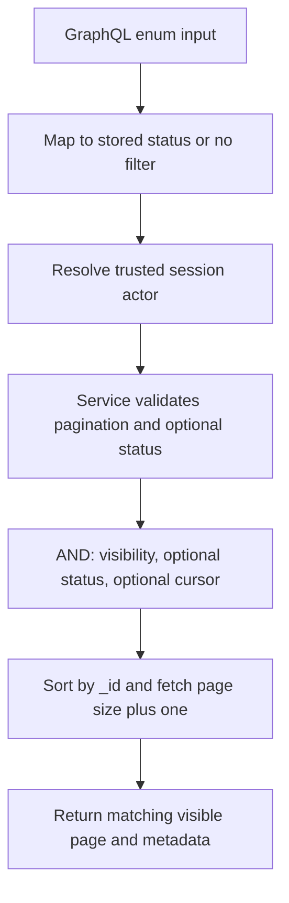

# Authorization design

Session authentication, post-list visibility, draft creation, title editing,
publication, and post-status filtering are implemented. Post services enforce
visibility before pagination, assign trusted ownership, and restrict edits and
publication to authors or admins. Publication requires an atomic state transition.

The publication feature PR has merged. The current status-filtering feature adds
service and GraphQL coverage, including status output from post mutations. Run the
verification commands below and confirm CI before merging; test code alone does
not establish a passing run.

Single-post lookup remains planned. Unpublishing, deletion, and ownership transfer
are outside the current implementation.

## Implementation status

| Capability | Status |
| --- | --- |
| Session identity through `context.getActor()` | Implemented |
| Published-only lists for anonymous visitors | Implemented and tested |
| Published posts plus own drafts for ordinary users | Implemented and tested |
| All posts for admins | Implemented and tested |
| Visibility filtering before cursor pagination | Implemented and tested |
| Authentication-storage failure without anonymous fallback | Implemented and tested |
| Single-post lookup | Planned |
| Draft creation with trusted ownership and initial status | Implemented; automated coverage added |
| Author/admin title editing with ownership in the update filter | Implemented; automated coverage added |
| Author/admin publication with atomic draft-state condition | Implemented; automated coverage added |
| Public post status and authorization-aware status-filtered lists | Implemented; automated coverage added |

See [session authentication](authentication/README.md) for the identity lifecycle.

## Identity and post status

- An actor is an authenticated user with a user ID and a role:
  user or admin.
- Anonymous requests have no actor.
- "Post author" means the authenticated user whose ID matches
  the post's authorId. It is a relationship, not a global role.
- Posts have a status of draft or published.
- Existing seed posts have been marked published.

## Permissions

| Action | Anonymous | Signed-in non-author | Post author | Admin |
|---|---|---|---|---|
| Read published posts | Allowed | Allowed | Allowed | Allowed |
| Read a draft | Denied | Denied | Allowed | Allowed |
| Create a draft | Denied | Allowed | Allowed | Allowed |
| Edit a post | Denied | Denied | Allowed | Allowed |
| Publish a draft | Denied | Denied | Allowed | Allowed |

Creating a draft assigns the authenticated actor as its author.
Clients cannot choose another author through this operation.

Publishing requires the post to currently be a draft, including
when the actor is an admin.

## Responsibility boundaries

| Responsibility | Question | Example |
|---|---|---|
| Authentication | Who is making this request? | Resolve a session to Grace |
| Object authorization | May this actor access this post? | Grace owns this draft |
| Business rules | Is the requested action valid now? | Only a draft can be published |

A valid session establishes identity. It does not grant access
to every post.

### Enforcement location



The post-list service enforces read visibility. The draft-creation service requires
an authenticated actor, validates the title, and assigns ownership and draft status.
The title-editing service includes ownership in the database update condition.
The publication service enforces authorization and draft status in the same update.
GraphQL resolvers obtain a trusted actor from request context and
pass it to those services.

Future REST routes, administrative commands, and background jobs
must use the same services with an explicitly established identity.
Calling from an internal entry point does not automatically grant access.

GraphQL arguments cannot establish or override the actor's identity.

## Reading a single post (planned)



Published posts are publicly readable.
Drafts are readable only by their author or an admin.

The client-visible response for an inaccessible private post will
be chosen during implementation to avoid exposing its existence.

## Creating a draft (implemented)



### GraphQL contract

```graphql
input CreateDraftInput {
  title: String!
}

extend type Mutation {
  createDraft(input: CreateDraftInput!): Post
}
```

The field is nullable so creation failures can return `createDraft: null` with an
error path. The shared `Post` output exposes `id`, `title`, `status`, and `author`.
Creation returns `status: DRAFT`; the stored document retains lowercase `draft`.

```graphql
mutation CreateDraft($input: CreateDraftInput!) {
  createDraft(input: $input) {
    id
    title
    status
    author {
      id
      name
    }
  }
}
```

Example variables:

```json
{
  "input": {
    "title": "  My first private draft  "
  }
}
```

Use the session cookie from login and the header `X-GraphQL-Auth: 1`. The existing
request guard requires POST and rejects a supplied Origin that does not exactly
match the configured application origin. It runs before session lookup or writes.

### Title policy

| Rule | Behavior |
| --- | --- |
| Input type | String; service validation rejects non-string values |
| Leading and trailing whitespace | Trim before validation and storage |
| Empty or whitespace-only value | Reject |
| Length after trimming | 1-200 Unicode code points |
| Internal whitespace | Preserve |

The validator uses `Array.from(title).length`, rather than JavaScript string length,
to count Unicode code points. A displayed symbol can contain multiple code points;
this is not a grapheme-count limit. Password whitespace rules are separate and
remain unchanged.

### Service contract and ownership

```typescript
createDraft(database, actor, { title })
// Promise<PostDocument>
```

The service accepts a trusted `Actor | null`. It requires authentication before
title validation, generates a UUID with `randomUUID()`, assigns
`authorId: actor.userId`, and sets `status: "draft"`.

Both ordinary users and admins create drafts under their own identity. The service
constructs the document explicitly instead of spreading input. Extra runtime input
properties cannot override the ID, author, or status. At the GraphQL boundary,
unknown input fields are rejected before resolver execution.

The service has no GraphQL, Express, or cookie dependency. Another entry point must
establish identity explicitly before passing an actor. Anonymous callers cannot
bypass authentication by calling the service directly.

New drafts immediately follow the existing visibility policy: the author and
admins can list them; anonymous visitors and other ordinary users cannot. IDs are
UUID strings, so existing `_id` ordering is lexicographic, not creation-time order.

### Error behavior

| Failure | GraphQL behavior | Write behavior |
| --- | --- | --- |
| Request guard rejects method, header, or Origin | FORBIDDEN | No session lookup or insert |
| No valid authenticated actor | UNAUTHENTICATED | No insert |
| Title fails service validation | BAD_USER_INPUT | No insert |
| Input includes unknown fields such as authorId, status, or id | GraphQL input rejection before execution | No insert |
| Session lookup fails | SERVICE_UNAVAILABLE; existing authentication error preserved | No insert attempted |
| Post storage fails | SERVICE_UNAVAILABLE; generic draft-creation message | No successful creation claimed |

Database errors propagate from the service and are sanitized at the resolver
boundary. The actor lookup remains outside the creation error handler so its
existing authentication-failure contract is preserved.

An author field is resolved after the insert through the shared DataLoader. A later
field-resolution failure does not roll back the inserted draft. Likewise, a network
or acknowledgement failure does not guarantee that a write was never committed;
automatic retries are not an idempotency guarantee for this mutation.

### Implementation and coverage

Paths are relative to `backend/`.

| File | Responsibility |
| --- | --- |
| `src/posts/errors.ts` | Transport-independent authentication and title errors |
| `src/posts/titles.ts` | Title normalization and validation |
| `src/posts/titles.test.ts` | Whitespace, type checks, and Unicode length boundaries |
| `src/posts/service.ts` | Require actor, generate ID, assign ownership/status, insert draft |
| `src/resolvers/create-draft.ts` | Request guard, actor lookup, service call, error mapping |
| `src/resolvers/post.ts` | Shared public post mapping and DataLoader author resolution |
| `src/graphql.ts` and `src/resolvers/index.ts` | Mutation schema and resolver registration |
| `tests/integration/create-draft.test.ts` | Direct service and GraphQL mutation coverage |

Automated scenarios cover:

- Ordinary users and admins owning their newly created drafts.
- Stored normalized titles, generated IDs, and draft status.
- Different IDs for separate creations, including repeated titles.
- Ignored ownership/status/ID overrides from non-GraphQL callers.
- Anonymous and invalid-title rejection without insertion.
- Invalid headers and disallowed origins preventing creation.
- GraphQL input rejecting caller-selected ownership, status, or ID.
- Correct author fields through the request DataLoader.
- Created draft visibility for authors/admins and exclusion for other callers.
- Authentication failure and closed-client write failure without insertion in
  those controlled test scenarios.

Service tests use trusted actors directly. GraphQL tests use the real schema,
registered resolvers, cookie extraction, session lookup, and DataLoader with an
isolated MongoDB database. These tests do not exercise the full Express route.
The manual playground check verifies the browser mutation flow.

## Editing a post (implemented)



The diagram shows the database branch after validation. Anonymous requests,
invalid input, and rejected request guards stop before any update.

### GraphQL contract

```graphql
input UpdatePostInput {
  title: String!
}

extend type Mutation {
  updatePost(id: ID!, input: UpdatePostInput!): Post
}
```

```graphql
mutation UpdatePost($id: ID!, $input: UpdatePostInput!) {
  updatePost(id: $id, input: $input) {
    id
    title
    status
    author {
      id
      name
    }
  }
}
```

Example variables; replace the ID with an existing post the caller may edit:

```json
{
  "id": "your-post-id",
  "input": {
    "title": "  My updated title  "
  }
}
```

Use the login session cookie and `X-GraphQL-Auth: 1`. The request guard runs before
session lookup. `updatePost` is nullable, so a resolver failure returns a null field
with its error path rather than necessarily nulling the entire response.

### Service contract and validation

```typescript
updatePostTitle(database, actor, id, { title })
// Promise<PostDocument>
```

The service requires a trusted authenticated actor. It validates that the ID is a
nonempty string of at most 256 characters without trimming it; both seed IDs and
UUID post IDs are supported. The title uses the same normalization as creation:
trim boundaries, preserve internal whitespace, require 1-200 Unicode code points.

ID and title validation occur before the update. GraphQL rejects unknown input
fields. The service constructs `$set` explicitly, so extra runtime properties
cannot change the document ID, author, or status.

### Authorization at the write boundary

| Actor | MongoDB update filter |
| --- | --- |
| Anonymous | Rejected before database access |
| Ordinary user | `{ _id: id, authorId: actor.userId }` |
| Admin | `{ _id: id }` |

The update is `{ $set: { title } }`. `findOneAndUpdate` uses
`returnDocument: "after"` and `includeResultMetadata: false`, returning the updated
document or null. Both draft and published posts can be edited. An admin editing
another author's post does not become its author and does not change its status.

The ownership condition is evaluated as part of the write, rather than relying
only on an earlier read. If ownership no longer matches when the update executes,
an ordinary user's update cannot match. The role is the trusted actor's role
resolved for this request; this is not a transaction with later account-role changes.

Setting a title to its existing normalized value succeeds when an authorized post
matches. Concurrent authorized edits currently follow last-write-wins semantics;
optimistic version checks are not implemented.

### Missing and inaccessible posts

For valid input, a missing ID and an existing post owned by someone else both
produce `PostNotFoundError`. GraphQL maps both to `NOT_FOUND` with the message
`Post not found` and error path `["updatePost"]`.

This means no post available for this caller to edit. The response does not
explicitly confirm that another user's private post exists. Consistent errors do
not guarantee elimination of every possible timing or other side channel.

### Error behavior

| Failure | GraphQL result | Stored post |
| --- | --- | --- |
| Request guard rejected | FORBIDDEN | Unchanged |
| Anonymous actor | UNAUTHENTICATED | Unchanged |
| Invalid ID or title | BAD_USER_INPUT | Unchanged |
| Missing or inaccessible post | NOT_FOUND; same generic message | Unchanged |
| Unknown protected input field | GraphQL input rejection before execution | Unchanged |
| Authentication storage failure | SERVICE_UNAVAILABLE; existing authentication error preserved | No update attempted |
| Update storage failure | SERVICE_UNAVAILABLE; generic post-update message | No successful update claimed |

The resolver keeps actor lookup outside its update error handler. The service
propagates database errors, which the resolver sanitizes. A network or acknowledgement
failure does not establish that a database write never committed. A later author
field failure also does not roll back a completed title update.

### Implementation and test coverage

Paths are relative to `backend/`.

| File | Responsibility |
| --- | --- |
| `src/posts/errors.ts` | Invalid-ID and shared post-not-found errors, plus existing service errors |
| `src/posts/service.ts` | Validate actor/input and perform authorized atomic title update |
| `src/posts/titles.ts` | Shared title normalization and validation |
| `src/resolvers/update-post.ts` | Request checks, session identity, service call, and GraphQL errors |
| `src/resolvers/post.ts` | Shared post mapping and DataLoader author resolution |
| `src/graphql.ts` and `src/resolvers/index.ts` | Mutation schema and resolver registration |
| `tests/integration/update-post.test.ts` | Direct-service and GraphQL editing coverage |

Service tests cover author and admin edits of drafts and published posts, anonymous
and non-author rejection, identical missing/inaccessible errors, invalid IDs and
titles, ignored protected-property overrides, unchanged-title success, and a
closed-client storage failure. Rejected operations compare stored snapshots to
confirm documents remain unchanged in those controlled scenarios.

GraphQL tests use real session lookup and the registered schema/resolvers. They
cover successful title and author responses, rejected requests, missing/inaccessible
posts, invalid input, protected-field rejection, authentication failure, and update
failure. Each rejected edit verifies that stored posts remain unchanged. The tests
use an isolated MongoDB database and clean up only their owned fixtures/database;
they do not exercise the full Express HTTP route.

## Publishing a draft (implemented)



Request rejection, anonymous access, and invalid IDs stop before any publication
write. The actor lookup remains outside the resolver's publication error handler,
preserving authentication-storage errors without anonymous fallback.

### GraphQL contract

```graphql
extend type Mutation {
  publishPost(id: ID!): Post
}
```

```graphql
mutation PublishPost($id: ID!) {
  publishPost(id: $id) {
    id
    title
    status
    author {
      id
      name
    }
  }
}
```

Example variables:

```json
{
  "id": "replace-with-your-draft-id"
}
```

Use a login session cookie and `X-GraphQL-Auth: 1`. The server controls the status
transition; clients supply only the post ID. The field is nullable so execution
failure can produce `publishPost: null` with its error path.

The shared `Post` output includes `status`, so publication can return
`status: PUBLISHED`. Anonymous list visibility and a conflict on a repeated attempt
also confirm the transition. UUID sorting is lexicographic rather than chronological;
a published post may require pagination to locate.

### Service contract and atomic update

```typescript
publishPost(database, actor, id)
// Promise<PostDocument>
```

The service requires a trusted authenticated actor and an ID that is a nonempty
string of at most 256 characters. IDs are not trimmed. The authorization filter
is combined with `{ status: "draft" }` using `$and` in `findOneAndUpdate`.

| Actor | Required match |
| --- | --- |
| Anonymous | Rejected before database access |
| Ordinary user | ID matches, authorId equals actor.userId, and status is draft |
| Admin | ID matches and status is draft |

The update changes only `{ $set: { status: "published" } }`. The post ID, title,
and author remain unchanged. `returnDocument: "after"` and
`includeResultMetadata: false` return the updated document or null.

Authorization answers whether the actor may publish this post. The state rule
answers whether it is still a draft. An admin passes the ownership restriction
but must still satisfy the state rule.

If the update returns null, a second lookup uses the same authorization filter
without a status condition. No match produces `PostNotFoundError`; an accessible
post produces `PostPublicationConflictError`. This lookup classifies a failed
update and never authorizes a later write. It also preserves the same not-found
response for nonexistent and inaccessible IDs.

### Concurrent attempts and repeated publication



Either caller may win. For an unchanged accessible post, exactly one of two
concurrent attempts succeeds and the other conflicts. The same state rule makes
repeated publication a conflict, including for admins. Publication is deliberately
not idempotent-success behavior like logout.

The authorized follow-up lookup observes a later database state. If a future
feature permits deletion or ownership transfer between operations, failure may be
classified as NOT_FOUND instead of CONFLICT. The atomic write condition still
prevents an unauthorized or repeated transition. Account roles are resolved for
the request, not transactionally locked against future role changes.

### Error behavior

| Failure | GraphQL code | Public message |
| --- | --- | --- |
| Request guard rejected | FORBIDDEN | Authentication request rejected |
| Anonymous actor | UNAUTHENTICATED | Authentication required |
| Invalid ID | BAD_USER_INPUT | Post ID must contain between 1 and 256 characters |
| Missing or inaccessible post | NOT_FOUND | Post not found |
| Authorized caller cannot transition an accessible post from draft | CONFLICT | Post is no longer a draft |
| Authentication storage fails | SERVICE_UNAVAILABLE | Authentication temporarily unavailable |
| Publication storage or follow-up lookup fails | SERVICE_UNAVAILABLE | Post publication temporarily unavailable |

A non-author receives NOT_FOUND for both draft and published posts; the conflict
response does not expose state to that caller. Database errors propagate from the
service and are sanitized by the resolver.

A network or acknowledgement failure can leave the write outcome uncertain.
Likewise, failure resolving the author field after publication does not roll back
the completed state transition. A retry must not be assumed to be the first attempt.

### Implementation and test coverage

Paths are relative to `backend/`.

| File | Responsibility |
| --- | --- |
| `src/posts/errors.ts` | Publication conflict and shared service errors |
| `src/posts/service.ts` | Actor/ID validation, conditional publication, authorized failure lookup |
| `src/resolvers/publish-post.ts` | Request guard, identity, service call, GraphQL error mapping |
| `src/resolvers/post.ts` | Shared post mapping and DataLoader author resolution |
| `src/graphql.ts` and `src/resolvers/index.ts` | Publication mutation and resolver registration |
| `tests/integration/publish-post.test.ts` | Service and GraphQL authorization, state, and concurrency coverage |

The test suite covers:

- Author and admin success, preserving ID, title, and ownership.
- Anonymous rejection and invalid IDs without stored changes.
- Identical NOT_FOUND behavior for missing and inaccessible posts, including
  non-author attempts against already published posts.
- Repeated publication conflicts for both authors and admins.
- Concurrent direct-service attempts yielding one success and one conflict.
- Concurrent independent GraphQL requests yielding one success and one conflict.
- Correct author fields through DataLoader.
- Anonymous visibility before and after publication through service and GraphQL.
- Rejected headers and origins leaving posts unchanged.
- Authentication failure and closed-client write failure returning generic errors,
  with unchanged snapshots in those controlled scenarios.

GraphQL tests execute the real schema and registered resolvers with session-cookie
extraction and actual session lookup. Each concurrent call has its own context.
They do not exercise the full Express HTTP route. Test fixtures live in a uniquely
owned database under the integration-test setup and are removed during cleanup.

## Listing posts with pagination (implemented)



### Visibility filters

| Actor | MongoDB filter |
| --- | --- |
| Anonymous | `{ status: "published" }` |
| Ordinary user | `{ $or: [{ status: "published" }, { status: "draft", authorId: actor.userId }] }` |
| Admin | `{}` |

The actor comes from the session, never a GraphQL argument. An ordinary user's
ownership is checked against the stored `authorId`. Anonymous users also exclude
records without a recognized published status.

When a cursor exists, the query combines the visibility filter with
`{ _id: { $gt: afterId } }` using `$and`. Sorting and limiting operate on the
visible set. A cursor is a position, not proof that the caller may read the post
at that position; guessing a draft's ID does not grant access to it.

### Service contract and boundaries

```typescript
listVisiblePosts(database, actor, { pageSize, afterId, status? }, logDatabaseCall?)
// Promise<{ posts: PostDocument[]; hasNextPage: boolean }>
```

The service accepts a trusted `Actor | null` and decoded pagination values.
It independently validates an integer page size from 1 to 20 and an `afterId`
that is either null or a nonempty string of at most 256 characters. This protects
bounds even when another entry point calls it without GraphQL validation. Optional
status accepts lowercase `draft` or `published`; undefined and null add no status
constraint. Other runtime values throw `InvalidPostStatusError` before querying.

The service has no dependency on GraphQL, Express, cookies, or request context.
Database errors propagate to its caller. GraphQL validates and decodes the public
arguments, resolves identity, maps service results to API objects, and converts
post database failures into generic `SERVICE_UNAVAILABLE` errors.

Authentication lookup occurs outside the resolver's post-database error handler.
An authentication failure therefore preserves its existing error instead of
falling back to anonymous visibility. Since `Query.posts` is non-null, an execution
error there propagates to root `data: null`, with an error path of `["posts"]`.

Author resolution still uses the request-scoped DataLoader, and the `graphql.posts`
span still wraps the resolver. Authenticated requests now perform session identity
lookups in addition to the post query and author batch.

### Pagination example

For an anonymous caller, consider this stored order:

| ID | Status | Visible? |
| --- | --- | --- |
| post-01 | Published | Yes |
| post-02 | Draft | No |
| post-03 | Draft | No |
| post-04 | Published | Yes |
| post-05 | Draft | No |
| post-06 | Draft | No |

With `first: 2`, the result is `post-01` and `post-04`, with `hasNextPage: false`.
The drafts neither consume page slots nor imply an additional visible page.
Filtering after the limit would produce short pages or misleading metadata.

The public connection contract is unchanged: each edge has an encoded cursor,
`endCursor` comes from the last returned edge, and an empty page has a null
`endCursor`. The service fetches one extra visible document solely to determine
`hasNextPage`, then returns the requested number of posts.

### Implementation map

Paths are relative to `backend/`.

| File | Responsibility |
| --- | --- |
| src/posts/visibility.ts | Build actor-dependent visibility filters |
| src/post-status.ts | Explicit GraphQL enum and stored-status mapping |
| `src/posts/service.ts` | Validate bounds and return visible pages; also create authenticated drafts |
| src/resolvers/posts.ts | Validate GraphQL arguments, get actor, call service, map connection, trace |
| src/resolvers/post.ts | Shared post mapping and DataLoader author resolution |
| `src/auth/request-actor.ts` | Lazy identity lookup shared within one request |
| `tests/integration/post-visibility.test.ts` | Direct-service and GraphQL authorization/pagination coverage |

## Field exposure

Document access does not mean every stored field is public.

Resolvers must return explicitly selected API fields.
Password hashes, session data, and other internal credentials
must never be exposed through user or post results.

## Verified post-list scenarios

The service tests call `listVisiblePosts` directly with trusted actors. GraphQL
tests execute the real schema and registered resolvers with cookie extraction,
session resolution, and request-scoped DataLoader helpers. They verify the resolver
path, rather than the complete Express HTTP transport.

| Scenario | Verified result |
| --- | --- |
| Anonymous caller lists mixed published posts and drafts | Published posts only |
| Ada or Grace lists posts | Published posts and only that user's drafts |
| Admin lists posts | All posts |
| Hidden drafts lie between published posts | They do not consume visible page slots |
| Only hidden drafts remain after the page | hasNextPage is false |
| An author paginates across visible pages | Stable order, correct cursors, no skipped visible records |
| Anonymous caller uses a draft ID as cursor boundary | Only subsequent visible posts are returned |
| Cursor follows the last visible post | Empty page; no next page |
| Direct service caller supplies invalid page size or boundary | Rejected |
| GraphQL requests authors on visible posts | Correct author names through DataLoader |
| Session authentication storage fails | SERVICE_UNAVAILABLE; no published-only fallback |

Fixtures use interleaved published posts and drafts in a uniquely named database
under the guarded integration-test namespace. Cleanup drops only that test's
owned database. Its name stays within MongoDB's database-name limit.

```bash
docker compose exec backend npm run format:check
docker compose exec backend npm run typecheck
docker compose exec backend npm test
docker compose --profile test run --rm integration-tests
```

Make small commits after verified checkpoints. Check the final CI results before
merging; a local verification result does not itself confirm CI success.

## Planned authorization scenarios

Single-post lookup remains future work.

| Scenario | Expected |
| --- | --- |
| Anonymous visitor requests a published post by ID | Allowed |
| Anonymous visitor or non-author requests a draft by ID | Inaccessible; response contract to be defined |
| Author or admin requests a draft by ID | Allowed |
| Future entry point invokes a post service | Same policy enforced using explicitly established identity |

## Post-status exposure and filtering (implemented)

### Schema and mapping

```graphql
enum PostStatus {
  DRAFT
  PUBLISHED
}

type Post {
  id: ID!
  title: String!
  status: PostStatus!
  author: User
}

extend type Query {
  posts(first: Int = 5, after: String, status: PostStatus): PostConnection!
}
```

The query declaration illustrates the current field signature; update the existing
`posts` field rather than defining a duplicate field in an executable schema.

| GraphQL value | Stored/service value |
| --- | --- |
| DRAFT | `draft` |
| PUBLISHED | `published` |
| Omitted or null status argument | No additional status constraint |

`fromGraphQLPostStatus` explicitly maps input values before actor lookup.
`toGraphQLPostStatus` maps stored values in the shared post mapper. It rejects an
unexpected stored status instead of silently treating it as published. Invalid
GraphQL enum values are rejected before resolver execution; direct service callers
also receive runtime status validation.

Existing clients can omit the argument and need not select the new status field.
Their result selection and visibility policy remain unchanged.

### Filtered query

```graphql
query DraftPosts($after: String) {
  posts(first: 5, after: $after, status: DRAFT) {
    edges {
      cursor
      node {
        id
        title
        status
        author {
          name
        }
      }
    }
    pageInfo {
      hasNextPage
      endCursor
    }
  }
}
```

Start with `{ "after": null }`. Follow `endCursor` while `hasNextPage` is true,
keeping the same status filter. Use `status: PUBLISHED` for published posts.
Listing all matching drafts requires following pages; the existing 20-post maximum
per page remains in force.

| Caller | DRAFT filter | PUBLISHED filter | Omitted or null filter |
| --- | --- | --- | --- |
| Anonymous | Empty result | Published posts | Published posts |
| Ordinary user | Own drafts only | Published posts | Published posts and own drafts |
| Admin | All drafts | Published posts | All posts |

Anonymous draft queries return empty edges, `hasNextPage: false`, and
`endCursor: null`, without an authorization error. Filtering restricts the visible
set; it never grants permission.

### Combining constraints before pagination



The service always includes the actor's visibility filter. For an anonymous draft
query, the filter contains both published visibility and requested draft status:

```typescript
{
  $and: [
    { status: "published" },
    { status: "draft" },
  ],
}
```

These conditions cannot match the same post, so no drafts are disclosed. With a
cursor, `{ _id: { $gt: afterId } }` is another AND condition. The service sorts and
limits only the resulting authorized, status-matching set. Hidden drafts and posts
of the other status cannot consume page slots or imply another matching page.

The cursor remains the encoded post ID; it does not bind the actor or status.
Clients must retain the same filter when continuing a result set. Changing status
while reusing a cursor applies that position to a different filtered set; it is not
a continuation of the original list. Concurrent edits/publication can also change
membership between requests; pagination is not a database snapshot.

### Mutation output and coverage

The shared `toGraphQLPost` mapper is used by listing, creation, editing, and
publication. Selecting status on mutations returns:

| Mutation | Returned status |
| --- | --- |
| createDraft | DRAFT |
| updatePost | Existing status, unchanged by title editing |
| publishPost | PUBLISHED |

The enum field is output-only for these mutations: creation still assigns draft
status, editing still accepts only a title, and publication controls its own
transition. Exposing status does not permit clients to set arbitrary state.

Service coverage tests every caller category with draft and published filters,
omitted/null behavior, filtered pagination, empty results, and invalid runtime
status values. GraphQL coverage checks the enum mapping, caller visibility matrix,
filter-specific cursors/page metadata, and invalid enum rejection. Mutation tests
request status and assert the correct uppercase response values while retaining
lowercase stored-document assertions.

The existing GraphQL tests without status selections remain to verify compatibility.
Test files are `tests/integration/post-visibility.test.ts`,
`tests/integration/create-draft.test.ts`, `tests/integration/update-post.test.ts`,
and `tests/integration/publish-post.test.ts`, relative to `backend/`.

The feature adds no index migration or query-plan guarantee. Query performance for
the combined filters should be measured separately before adding indexes.
