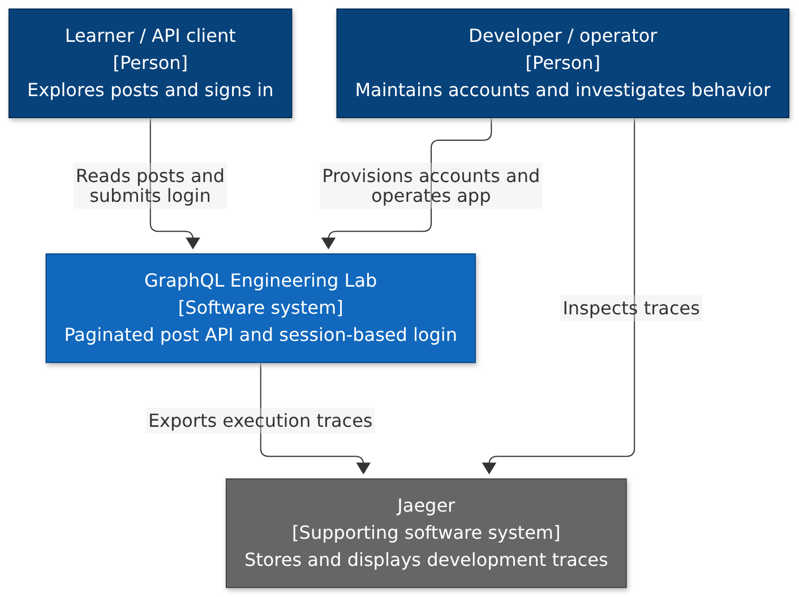
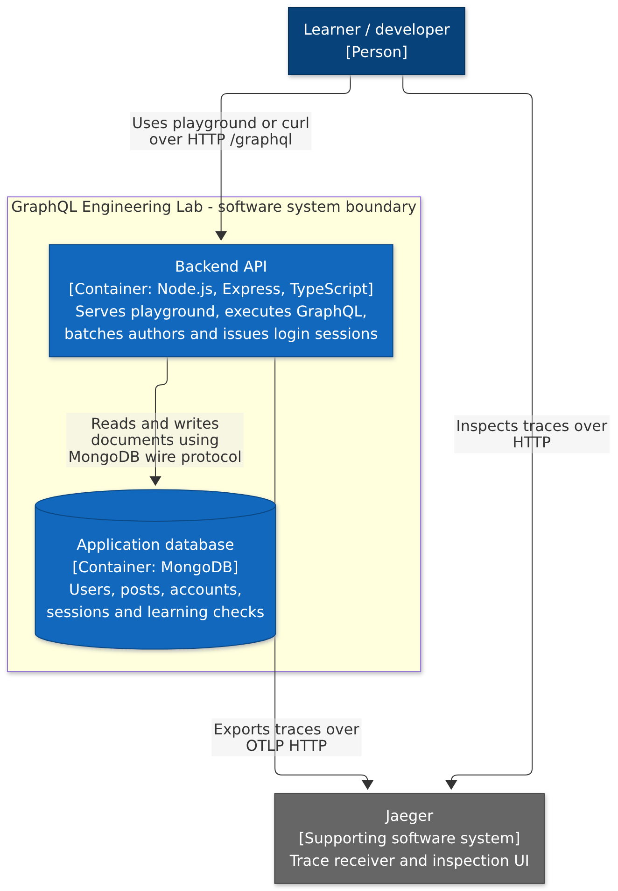
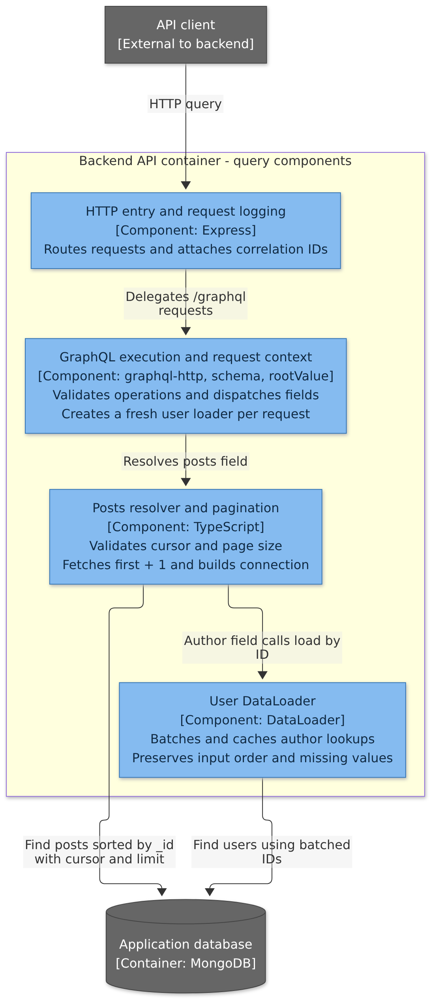
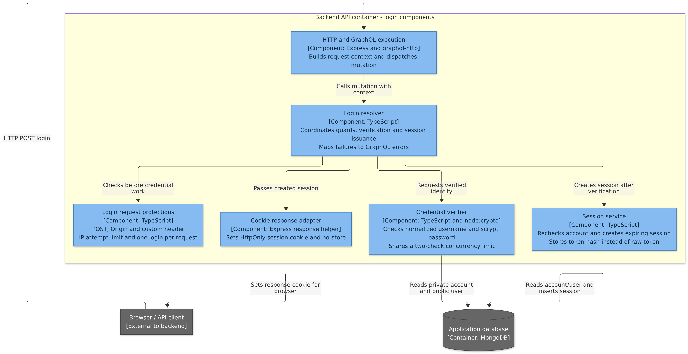

# C4 architecture views

Snapshot: 17 October 2026. Read these views in order: system context, containers, then components. The diagrams describe the current implementation, including the login checkpoint.

The C4 model changes the level of detail at each zoom. A container in C4 means an application or data store; it does not specifically mean a Docker container. Components are modules within one application, not independently deployed services. These views use Mermaid flowcharts with explicit C4 element types and responsibilities; they are not generated from a Structurizr model.

## Level 1 - System context

Question: Who uses our system, and what other systems does it interact with?

[Editable source](diagrams/c4-context.mmd)

Our software system is the post API and its authentication capability. Jaeger is shown as a supporting system outside that product boundary, although we run it in the same Compose project. Docker networking is a deployment boundary, not the software-system boundary.

Interview explanation: "The lab lets clients read posts and sign in. Developers provision accounts and use exported traces to investigate requests."

## Level 2 - Containers

Question: Which applications and data stores carry out those responsibilities?

[Editable source](diagrams/c4-containers.mmd)

The backend and application database are the two main containers inside our software system. Ruru is a browser-based client served by the backend, not a separately deployed frontend service. Jaeger remains a supporting system. Named volumes, host ports, k6 and CI are documented in the [deployment and verification blueprint](architecture.md), rather than mixed into this logical view.

Interview explanation: "One Express backend handles GraphQL and talks to MongoDB. It exports OpenTelemetry traces to Jaeger. This is a modular monolith."

## Level 3 - Backend query components

Question: How does the backend divide the work for posts and authors?

[Editable source](diagrams/c4-query-components.mmd)

This view zooms into the backend container only. MongoDB is outside that container boundary but remains inside the overall software system. The user loader is created per request. Pagination bounds each selected list field; DataLoader batches author lookup work. The diagrams show dependencies and responsibilities; the [sequence diagrams](architecture.md#follow-a-posts-query) describe execution order.

Other implemented root fields, such as hello and learningCheck, are omitted from this focused query view for clarity. HTTP, Express and MongoDB instrumentation plus custom query/batch spans are cross-cutting concerns shown in the main architecture guide.

Interview explanation: "The transport builds context and dispatches resolvers. The posts resolver validates pagination and returns a connection. Author fields use the request's loader, which batches unique IDs into a MongoDB query."

## Level 3 - Backend login components

Question: How do we separate login orchestration, request protections and authentication services?

[Editable source](diagrams/c4-login-components.mmd)

These components run inside the same backend process as the query components. The HTTP/GraphQL component appears in both views because it is shared. The request guards protect login attempts, while the credential verifier controls expensive password checks. Session storage must succeed before the cookie callback runs. Scrypt uses Node's worker pool; it is not a separate network service.

Interview explanation: "The resolver coordinates small services. Request guards reject disallowed attempts, the verifier checks credentials with bounded hashing capacity, the session service stores an expiring token hash, and the response adapter delivers the raw token as an HttpOnly cookie."

## Scope and next steps

The current diagrams deliberately stop at session issuance. Incoming cookie-to-actor authentication, me, logout, draft visibility and other authorization enforcement are future work. Depth and whole-operation complexity protection are deferred. A posted authorization policy does not mean those checks are implemented.

We have not added Level 4 code diagrams: the source files and existing tests provide the useful detail at this stage. Use the existing sequence diagrams for runtime behavior and the overview for local Docker deployment.

For an interview, start with Level 1, move to Level 2, then select either Level 3 view based on the question. Explain one request path before discussing tradeoffs. Avoid presenting every implementation detail at once.

## Rendering and maintenance

All diagrams are committed PNG images, so the viewer does not need Mermaid support. Their .mmd sources are committed beside them. Use the Docker instructions in [diagrams/README.md](diagrams/README.md), including the four c4 diagram names, to regenerate images after changes. No host installation is needed.

Model references: [system context](https://c4model.com/diagrams/system-context), [containers](https://c4model.com/diagrams/container), and [components](https://c4model.com/diagrams/component).
