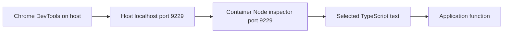

# Debugging Node.js TypeScript tests in Docker

Use this guide to pause a single test, inspect its variables, and step into application code using Chrome DevTools. Node, TypeScript tooling, and test dependencies run inside Docker; no host Node installation is required.

The examples use this repository's Node 26 backend service and WSL Bash terminal. For another project, substitute its Compose service, container working directory, test path, and test name. The project must already support the Node test runner and have tsx installed if using the TypeScript command below.

## How the pieces connect



The inspector connection controls execution. It is separate from application HTTP ports and does not require starting the development server.

## 1. Add a pause point

In `backend/src/user-service/batches.test.ts`, put `debugger;` immediately before the function you want to explore:

```typescript
test("splits batches when UTF-8 bytes exceed the request budget", () => {
  const ids = Array.from(
    { length: 100 },
    (_, index) => `${"界".repeat(250)}${index.toString().padStart(3, "0")}`,
  );

  debugger;

  const batches = buildProfileBatches(ids);

  // Keep the existing assertions.
});
```

Save the file before running the command. A DevTools line breakpoint is an alternative to adding `debugger;` to the source.

## 2. Start one test in a temporary container

Run from the repository root, where Compose can locate `compose.yaml`:

```sh
docker compose run --rm --no-deps \
  -p 127.0.0.1:9229:9229 \
  backend \
  node \
  --inspect-brk=0.0.0.0:9229 \
  --import tsx/esm \
  --test \
  --test-isolation=none \
  --test-name-pattern="^splits batches when UTF-8 bytes exceed the request budget$" \
  src/user-service/batches.test.ts
```

Expect a `Debugger listening on ws://...` message and a pause. This is intentional: Node is waiting for the debugger to attach and resume execution.

### Docker options

| Part | Meaning |
| --- | --- |
| `docker compose` | Use the project's Compose service definitions |
| `run` | Start a new one-off container using a service's configuration |
| `--rm` | Remove that one-off container when it exits; source files and named dependency volumes remain |
| `--no-deps` | Do not start dependent services for this run; appropriate for this pure unit test |
| `-p 127.0.0.1:9229:9229` | Publish container port 9229 on host loopback port 9229 |
| `backend` | Choose the service whose image, environment, working directory, mounts, and user settings are reused |
| `node ...` | Replace that service's normal command with this debugging command |

`run` does not publish the service's normal configured ports by default. This command publishes only the explicitly requested debugger port, so it can coexist with the normal backend on port 4000. The configured image entrypoint is still used; this command replaces the service command, not its entrypoint.

`--no-deps` does not remove networking or guarantee a test cannot reach a database. For integration tests, use the project's isolated test service and test database configuration. Do not point destructive tests at development data merely because they run in a temporary container.

### Port mapping explained

```text
-p 127.0.0.1:9229:9229
   └────┬────┘ └─┬┘ └─┬┘
     host IP   host  container
               port    port
```

Node listens on `0.0.0.0` inside the container so the forwarded connection can reach it. Docker publishes the port on host `127.0.0.1` so it is available locally rather than on every host interface. Other containers on a reachable network may still reach the container's inspector. Use this only for local debugging: the inspector grants control over the process.

### Node options

| Part | Meaning |
| --- | --- |
| `node` | Run the Node executable inside the container |
| `--inspect-brk=0.0.0.0:9229` | Enable the inspector on the container interface and pause at startup |
| `--import tsx/esm` | Preload the project's tsx ESM support before loading TypeScript tests |
| `--test` | Run Node's test runner |
| `--test-isolation=none` | Execute tests in the runner process rather than separate test-file child processes, simplifying attachment |
| `--test-name-pattern="^...$"` | Run tests whose names match this regular expression |
| `src/user-service/batches.test.ts` | Select the test file, relative to the container working directory (`/app` here) |

`^` and `$` anchor the regular expression to the complete name. A pattern is not a literal string: punctuation such as parentheses or dots may need escaping in other test names. For nested subtests, account for the full hierarchical name and ensure the parent test is selected so its callback can register the child.

The file is still evaluated to register tests; name filtering does not prevent top-level imports or setup code from running. Isolation is disabled only for this debug run; leave normal test scripts unchanged.

For JavaScript projects that do not use tsx, omit `--import tsx/esm`. For projects using another test runner, use that runner's filtering and debugging options rather than copying Node's `--test` flags.

### Shell syntax

The trailing backslashes continue a command onto the next line in Bash. They must be the last character on each continued line: no trailing spaces. These examples target WSL Bash, not PowerShell. A single-line version needs no continuation characters.

## 3. Attach Chrome

1. Open `chrome://inspect/#devices` in Chrome.
2. Click **Configure** and add `localhost:9229` if it is not listed.
3. Find the Node target under Remote Target and click **inspect**.
4. Use **Resume** (usually F8) to move from the initial startup pause to the `debugger;` statement in the test.

The WebSocket URL includes a session-specific identifier. It changes when the Node process restarts; the host and port can stay the same.

If TypeScript files are not immediately visible, search Sources for `batches.test.ts` or `batches.ts`. Ensure source maps are enabled in DevTools. The project bind mount lets the container read saved source edits; transformed code may appear alongside mapped TypeScript.

## 4. Step through the code

| Action | Common Chrome shortcut | Use |
| --- | --- | --- |
| Resume | F8 | Run to the next breakpoint or completion |
| Step over | F10 | Execute the current statement without entering its function |
| Step into | F11 | Enter a called function such as buildProfileBatches |
| Step out | Shift+F11 | Finish the current function and return to its caller |
| Toggle breakpoint | Click a line number | Pause before that line executes |

Keyboard mappings can differ by platform or settings; use the matching toolbar buttons when necessary. If the pause is on `debugger;`, step over it first, then step into the following function call. Stepping over the function call executes the whole function, so use Step Into to see its loop.

Use **Scope** for local variables, **Watch** for expressions, and **Call Stack** to select the function frame whose variables you want to inspect. The highlighted line normally has not executed yet.

Useful expressions in the test:

```typescript
ids.length
Buffer.byteLength(JSON.stringify({ ids }), "utf8")
```

Useful expressions inside `buildProfileBatches`:

```typescript
uniqueIds.length
current.ids.length
candidate.ids.length
Buffer.byteLength(candidate.body, "utf8")
MAX_REQUEST_BYTES
batches.length
```

`candidate` exists only after its declaration and within the loop. An expression can be unavailable when paused in another frame or before initialization.

Watch the candidate grow. When it exceeds the byte budget, the code saves the previous current batch and starts a new one with the ID that did not fit. Inspecting this transition is the purpose of the exercise.

Debugger pauses distort elapsed time. Do not use a paused session to assess performance, and expect real external deadlines to be affected while stepping through asynchronous network code.

## 5. Restart after a misclick or completed run

If the process is still paused, continue stepping or change breakpoints without restarting. Resuming cannot rewind code that already executed.

For a fresh run:

1. Keep Chrome open.
2. Press Ctrl+C in the terminal running the debug container.
3. Run the same Docker command again (Up Arrow in the terminal recalls it).
4. If the existing DevTools window offers **Reconnect**, try it. Otherwise return to `chrome://inspect/#devices` and click **inspect** on the new target.
5. Resume from startup to reach the test pause again.

A restarted process has a new inspector session, so the old DevTools window is not guaranteed to reconnect automatically. Chrome itself does not need to close. A page reload is not a reliable way to rerun a Node test.

If the terminal says `Waiting for the debugger to disconnect`, close that DevTools debugging window or disconnect it so Node can finish. Closing the entire Chrome browser is unnecessary.

## Troubleshooting

| Symptom | Check |
| --- | --- |
| Port 9229 is already allocated | Stop the previous debug container, or publish `127.0.0.1:9230:9229` and configure Chrome for localhost:9230 |
| Chrome cannot find the process | Check terminal startup errors, the published port, and the inspector's container bind address |
| Only the startup pause appears | Resume to the test pause; confirm the test pattern matches |
| Test callback does not run | Check exact name, regex escaping, nested parent selection, and test path |
| Breakpoint is skipped | Save the source file, enable breakpoints, and check that the edited file is the mounted file being executed |
| Command runs but no output appears | It may be waiting for debugger attachment or paused at a breakpoint |
| Node cannot find the test file | Use a path relative to the service's container working directory |
| Node cannot load tsx | Install project dependencies in its mounted dependency volume; do not install Node on the host |
| Compose reports a missing environment variable | Supply the project's required local configuration; Compose interpolation still applies to one-off runs |

## Before committing

Remove temporary `debugger;` statements and debug-only changes. Run the normal checks afterward:

```sh
docker compose exec backend npm run format:check
docker compose exec backend npm run typecheck
docker compose exec backend npm test
```

Do not add inspector flags or disable test isolation in CI merely to support a local debugging session.

## References

- [Docker Compose run: command overrides, dependency startup, port publishing, and cleanup](https://docs.docker.com/reference/cli/docker/compose/run/)
- [Node debugger and Chrome inspector integration](https://nodejs.org/api/debugger.html)
- [Node CLI options, including test isolation and name filtering](https://nodejs.org/api/cli.html)
