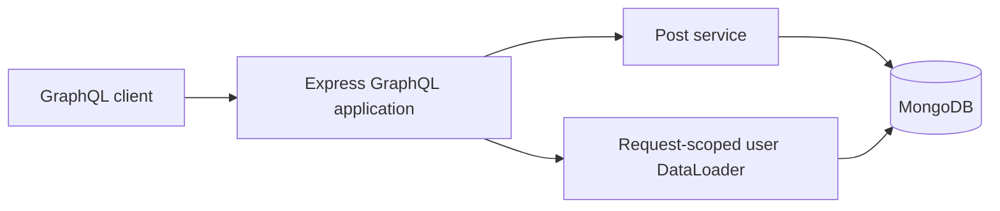
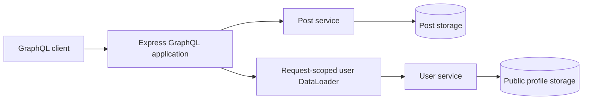
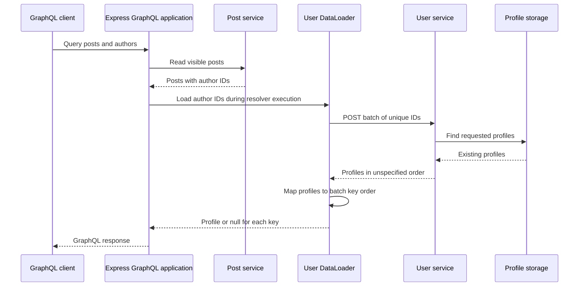

# Distributed GraphQL

## Goal

Explore how our Express GraphQL API retrieves data across service boundaries while preserving batching, authorization, and useful partial responses.

We will begin with explicit service calls. Federation remains a design comparison for a later checkpoint.

This document describes the proposed design. Service delegation is not implemented yet.

## Proposed ownership

| Component | Owns |
| --- | --- |
| Express GraphQL application | Public schema, resolvers, request context, and response composition |
| Post service inside the application | Post storage, visibility rules, and post mutations |
| Authentication inside the application | Credentials, sessions, and trusted request identity |
| Separate user service | Public user profiles and batch profile lookup |

The user service will initially expose public profile fields only. Credentials, sessions, and roles remain with authentication.

A public profile lookup must not become a way to retrieve password hashes or grant permissions.

## Current flow

All data access currently happens within one application.



## Proposed flow

Post access stays local. Author profile lookup crosses a network boundary.



These are logical storage ownership boundaries. Separate services do not require separate MongoDB servers for this learning project.

The GraphQL application will stop reading public user profiles directly once delegation is implemented.

## Why batching still matters

Suppose a query returns five posts with these author IDs:

```text
user-2, user-1, user-2, user-3, user-1
```

Without batching, the GraphQL application could send five HTTP requests to the user service.

With request-scoped DataLoader, these lookups can become one batch containing:

```text
user-2, user-1, user-3
```

Calls must reach the same DataLoader instance within its batching window to share a batch. Loading authors one at a time with sequential awaits can still cause multiple requests.

DataLoader's batch function must return one result per supplied key in the original key order, including a missing result when appropriate. The service response may require mapping by ID to satisfy that contract.

The network boundary changes where data comes from. It does not remove the N+1 problem.

## Authorization boundary

The post service continues to decide which posts an actor may read or modify.

The user service owns access rules for the profile data it exposes. For this first exercise, its lookup contract contains public profile data only.

The GraphQL application combines the results into the public schema. Public profile data must not be used as a substitute for trusted session identity or authorization decisions.

## Batch lookup contract

The proposed user-service endpoint is `POST /internal/users/batch`. Our public client still sends GraphQL operations to Express. This HTTP endpoint is an internal dependency used by the GraphQL application's DataLoader.

### Request

```http
POST /internal/users/batch
Content-Type: application/json
```

```json
{
  "ids": ["user-3", "missing-user", "user-1"]
}
```

Initial validation rules:

- Require a JSON object containing only `ids`.
- Require `ids` to be an array with 1 to 100 entries.
- Require each ID to be a nonempty string of at most 256 characters.
- Treat IDs as opaque values: do not trim them or change their case.
- Allow repeated IDs; deduplicate them before querying storage.
- Bound the JSON request body to 32 KiB.

The 100-entry bound limits work per service call. It is an initial learning-project policy, not a measured capacity limit. Configure DataLoader's `maxBatchSize` to match it when implementing delegation. Larger batches must be split rather than sent as oversized requests.

### Successful response

```json
{
  "users": [
    { "id": "user-1", "displayName": "Ada" },
    { "id": "user-3", "displayName": "Linus" }
  ]
}
```

Return HTTP 200 with the existing requested profiles. Missing IDs are omitted; if none exist, return `{ "users": [] }`.

Each returned ID appears at most once and must have been requested. Response order is unspecified. Each profile contains only `id` and `displayName`, both strings. The user service maps its stored `name` to `displayName`; storage documents and authentication fields do not cross this boundary.

The GraphQL application validates the response before using it. Invalid JSON, malformed profiles, duplicate response IDs, and unrequested IDs are dependency failures, not evidence that users are missing.

### Mapping back to DataLoader keys

The batch function maps profiles by ID and then reconstructs the requested order:

```text
Batch keys:       [user-3, missing-user, user-1]
Service response: [Ada/user-1, Linus/user-3]
Batch results:    [Linus/user-3, null, Ada/user-1]
```

A missing profile produces `null` for that key. An unavailable service rejects the batch: it must not return an array of nulls that disguises an outage as missing data.

The public GraphQL schema continues to support both `User.name` and `User.displayName`. Its mapper can populate both fields from the service's `displayName` during the existing deprecation period.

### Endpoint outcomes

| Situation | HTTP status | Meaning |
| --- | --- | --- |
| Valid lookup, including missing IDs | 200 | Requested existing profiles are returned |
| Invalid request shape, IDs, or batch size | 400 | Caller must correct the request |
| Body exceeds 32 KiB | 413 | Caller must send a smaller body |
| Unsupported request content type | 415 | Caller must send JSON |
| Profile storage is unavailable | 503 | Dependency failed; no successful lookup result |
| Unexpected server failure | 500 | Internal failure; no successful lookup result |

Error responses use a generic envelope, for example:

```json
{
  "error": {
    "code": "SERVICE_UNAVAILABLE",
    "message": "User service temporarily unavailable"
  }
}
```

Do not include database details, credentials, or session tokens in responses. Internal service access controls, deadlines, and GraphQL error mapping are defined in the next checkpoint; the `/internal` path alone does not restrict access.

### Request sequence



This is the successful lookup path. The next checkpoint defines how failures affect nullable and non-null GraphQL fields.

## Deadlines and failure behavior

Each outgoing user-service batch lookup gets a 500 ms deadline. This is an initial local-development policy, not a production latency target derived from measurements.

The deadline covers the HTTP request, reading the response body, and asynchronous response processing until the lookup settles. Keep the abort timer active while reading the body, and clear it in `finally`. An abort signal cancels cooperative network work; it cannot preempt synchronous JavaScript such as JSON parsing. Bounded response sizes keep that work limited.

Initial client policy:

- Send one attempt per batch, with no automatic retry.
- Abort the outgoing request when its deadline expires.
- Bound response bodies to 64 KiB, enforcing the limit while reading even when Content-Length is absent or incorrect.
- Validate the response before resolving any batch results.
- Treat network errors, non-200 responses, invalid responses, and exceeded deadlines as dependency failures.
- Do not replace dependency failures with empty successful results.

The response limit is a starting policy that must be checked against supported profile lengths before implementation. The service contract will need a display-name length bound so valid maximum-size batches fit the response budget.

Retries can multiply load during an outage. We will first make failure behavior predictable before considering bounded retries or a circuit breaker.

This deadline applies to each user-service call. It is not a complete GraphQL operation timeout and does not cap every other resolver or database operation.

## GraphQL nullability and partial responses

The existing application schema declares:

```graphql
type Post {
  id: ID!
  title: String!
  author: User
  status: PostStatus!
}
```

`author` is nullable because it has no exclamation mark. GraphQL can therefore return a post even when its author is unavailable.

| Lookup outcome | Author field | GraphQL errors |
| --- | --- | --- |
| Profile exists | Public user object | None from the lookup |
| Valid response omits the requested ID | null | None from the lookup |
| Deadline exceeded | null | SERVICE_UNAVAILABLE at the author field path |
| Network error or non-200 response | null | SERVICE_UNAVAILABLE at the author field path |
| Malformed or oversized response | null | SERVICE_UNAVAILABLE at the author field path |

During delegation, update the author resolver's current database-specific error message to a generic dependency message such as `Author information temporarily unavailable`. Preserve the `SERVICE_UNAVAILABLE` code, and keep internal failure details in observability data rather than the public error.

### Missing profile example

For a query selecting a post's ID, title, and author, an absent profile produces a normal null result:

```json
{
  "data": {
    "post": {
      "id": "post-1",
      "title": "Learning GraphQL",
      "author": null
    }
  }
}
```

### Dependency failure example

An unavailable service also leaves the author null, but includes an error so clients can distinguish failure from missing data:

```json
{
  "errors": [
    {
      "message": "Author information temporarily unavailable",
      "path": ["post", "author"],
      "extensions": { "code": "SERVICE_UNAVAILABLE" }
    }
  ],
  "data": {
    "post": {
      "id": "post-1",
      "title": "Learning GraphQL",
      "author": null
    }
  }
}
```

Locations are omitted from this illustrative response. A list query identifies the affected author with a path such as `["posts", "edges", 0, "node", "author"]`. Aliases change the corresponding response-path names.

One failed batch can affect several author fields. GraphQL may report an error at each affected field path, even though the loader made only one failed HTTP request. Successful post data and unrelated fields remain available.

HTTP 200 alone does not establish GraphQL success: clients and load tests must inspect the `errors` array as well as `data`.

### What if author were non-null?

Changing the field to `author: User!` would change its failure boundary. GraphQL propagates a null or resolver error upward until it reaches a nullable field.

For the current connection shape:

```text
Post.author: User!             hypothetical non-null author
PostEdge.node: Post!           cannot contain the null post
PostConnection.edges: [PostEdge!]!  cannot contain a null edge
Query.posts: PostConnection!   cannot contain a null connection
Result: data becomes null for the operation
```

For `Query.post: Post`, the nullable root post field would stop propagation and become null instead. Keeping `author: User` preserves useful post data during a profile-service failure without changing the existing schema.

## Failure verification plan

| Scenario | Expected evidence |
| --- | --- |
| Repeated author IDs | Deduplicated IDs in each batch; results map to original keys |
| One requested profile is missing | Only that author is null; no dependency error |
| Service responds after the deadline | Lookup is aborted; affected authors are null with errors |
| Service cannot be reached | Same public dependency error; post fields remain available |
| Service returns invalid JSON or profile data | Batch fails rather than silently treating profiles as missing |
| Response exceeds the byte limit | Reading stops and the batch fails |
| One batch fails for several posts | Error paths identify affected authors; no request per post |
| Query does not select author | No user-service lookup |

These are planned checks, not completed implementation tests.

## Next design decisions

- Profile length bounds and final response-budget alignment.
- Trace-context propagation and useful dependency span attributes.
- Internal service access and Docker deployment configuration.
- Service delegation versus federation tradeoffs.
