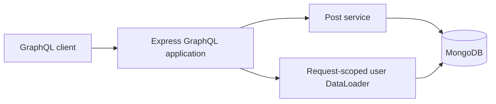
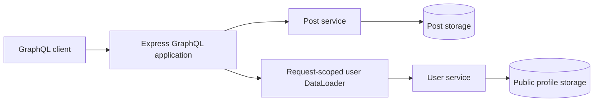

# Distributed GraphQL

## Goal

Explore how our Express GraphQL API retrieves data across service boundaries while preserving batching, authorization, and useful partial responses.

We will begin with explicit service calls. Federation remains a design comparison for a later checkpoint.

This document describes the proposed design. Service delegation is not implemented yet.

## Proposed ownership

| Component | Owns |
| --- | --- |
| Express GraphQL application | Public schema, resolvers, request context, and response composition |
| Post service inside the application | Post storage, visibility rules, and post mutations |
| Authentication inside the application | Credentials, sessions, and trusted request identity |
| Separate user service | Public user profiles and batch profile lookup |

The user service will initially expose public profile fields only. Credentials, sessions, and roles remain with authentication.

A public profile lookup must not become a way to retrieve password hashes or grant permissions.

## Current flow

All data access currently happens within one application.



## Proposed flow

Post access stays local. Author profile lookup crosses a network boundary.



These are logical storage ownership boundaries. Separate services do not require separate MongoDB servers for this learning project.

The GraphQL application will stop reading public user profiles directly once delegation is implemented.

## Why batching still matters

Suppose a query returns five posts with these author IDs:

```text
user-2, user-1, user-2, user-3, user-1
```

Without batching, the GraphQL application could send five HTTP requests to the user service.

With request-scoped DataLoader, these lookups can become one batch containing:

```text
user-2, user-1, user-3
```

Calls must reach the same DataLoader instance within its batching window to share a batch. Loading authors one at a time with sequential awaits can still cause multiple requests.

DataLoader's batch function must return one result per supplied key in the original key order, including a missing result when appropriate. The service response may require mapping by ID to satisfy that contract.

The network boundary changes where data comes from. It does not remove the N+1 problem.

## Authorization boundary

The post service continues to decide which posts an actor may read or modify.

The user service owns access rules for the profile data it exposes. For this first exercise, its lookup contract contains public profile data only.

The GraphQL application combines the results into the public schema. Public profile data must not be used as a substitute for trusted session identity or authorization decisions.

## Next design decisions

- Batch lookup request and response format.
- Missing-profile behavior.
- Timeout and service-unavailable behavior.
- GraphQL nullability and partial responses.
- Trace-context propagation.
- Internal service access and deployment configuration.
