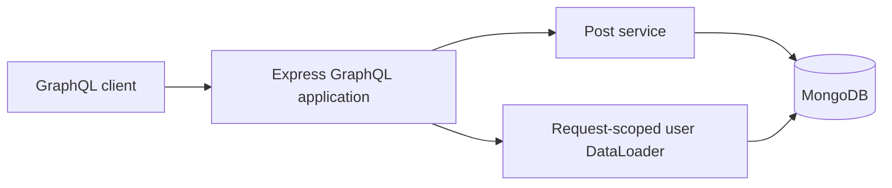
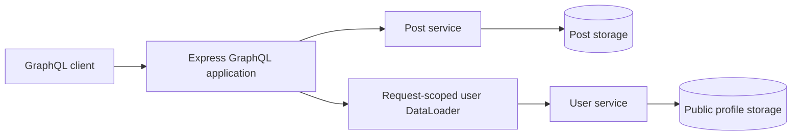
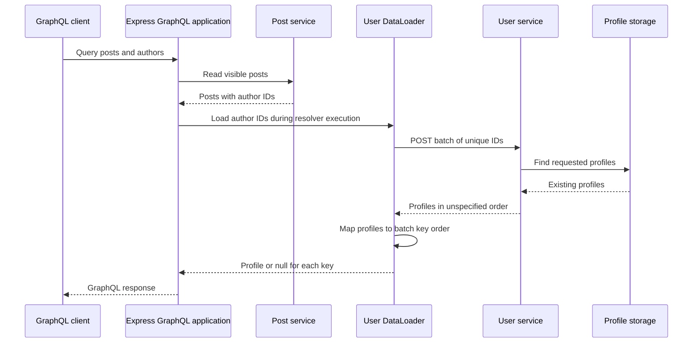

# Distributed GraphQL

## Goal

Explore how our Express GraphQL API retrieves data across service boundaries while preserving batching, authorization, and useful partial responses.

We will begin with explicit service calls. Federation remains a design comparison for a later checkpoint.

This document describes the proposed design. Service delegation is not implemented yet.

## Proposed ownership

| Component | Owns |
| --- | --- |
| Express GraphQL application | Public schema, resolvers, request context, and response composition |
| Post service inside the application | Post storage, visibility rules, and post mutations |
| Authentication inside the application | Credentials, sessions, and trusted request identity |
| Separate user service | Public user profiles and batch profile lookup |

The user service will initially expose public profile fields only. Credentials, sessions, and roles remain with authentication.

A public profile lookup must not become a way to retrieve password hashes or grant permissions.

## Current flow

All data access currently happens within one application.



## Proposed flow

Post access stays local. Author profile lookup crosses a network boundary.



These are logical storage ownership boundaries. Separate services do not require separate MongoDB servers for this learning project.

The GraphQL application will stop reading public user profiles directly once delegation is implemented.

## Why batching still matters

Suppose a query returns five posts with these author IDs:

```text
user-2, user-1, user-2, user-3, user-1
```

Without batching, the GraphQL application could send five HTTP requests to the user service.

With request-scoped DataLoader, these lookups can become one batch containing:

```text
user-2, user-1, user-3
```

Calls must reach the same DataLoader instance within its batching window to share a batch. Loading authors one at a time with sequential awaits can still cause multiple requests.

DataLoader's batch function must return one result per supplied key in the original key order, including a missing result when appropriate. The service response may require mapping by ID to satisfy that contract.

The network boundary changes where data comes from. It does not remove the N+1 problem.

## Authorization boundary

The post service continues to decide which posts an actor may read or modify.

The user service owns access rules for the profile data it exposes. For this first exercise, its lookup contract contains public profile data only.

The GraphQL application combines the results into the public schema. Public profile data must not be used as a substitute for trusted session identity or authorization decisions.

## Batch lookup contract

The proposed user-service endpoint is `POST /internal/users/batch`. Our public client still sends GraphQL operations to Express. This HTTP endpoint is an internal dependency used by the GraphQL application's DataLoader.

### Request

```http
POST /internal/users/batch
Content-Type: application/json
```

```json
{
  "ids": ["user-3", "missing-user", "user-1"]
}
```

Initial validation rules:

- Require a JSON object containing only `ids`.
- Require `ids` to be an array with 1 to 100 entries.
- Require each ID to be a nonempty string of at most 256 characters.
- Treat IDs as opaque values: do not trim them or change their case.
- Allow repeated IDs; deduplicate them before querying storage.
- Bound the JSON request body to 32 KiB.

The 100-entry bound limits work per service call. It is an initial learning-project policy, not a measured capacity limit. Configure DataLoader's `maxBatchSize` to match it when implementing delegation. Larger batches must be split rather than sent as oversized requests.

### Successful response

```json
{
  "users": [
    { "id": "user-1", "displayName": "Ada" },
    { "id": "user-3", "displayName": "Linus" }
  ]
}
```

Return HTTP 200 with the existing requested profiles. Missing IDs are omitted; if none exist, return `{ "users": [] }`.

Each returned ID appears at most once and must have been requested. Response order is unspecified. Each profile contains only `id` and `displayName`, both strings. The user service maps its stored `name` to `displayName`; storage documents and authentication fields do not cross this boundary.

The GraphQL application validates the response before using it. Invalid JSON, malformed profiles, duplicate response IDs, and unrequested IDs are dependency failures, not evidence that users are missing.

### Mapping back to DataLoader keys

The batch function maps profiles by ID and then reconstructs the requested order:

```text
Batch keys:       [user-3, missing-user, user-1]
Service response: [Ada/user-1, Linus/user-3]
Batch results:    [Linus/user-3, null, Ada/user-1]
```

A missing profile produces `null` for that key. An unavailable service rejects the batch: it must not return an array of nulls that disguises an outage as missing data.

The public GraphQL schema continues to support both `User.name` and `User.displayName`. Its mapper can populate both fields from the service's `displayName` during the existing deprecation period.

### Endpoint outcomes

| Situation | HTTP status | Meaning |
| --- | --- | --- |
| Valid lookup, including missing IDs | 200 | Requested existing profiles are returned |
| Invalid request shape, IDs, or batch size | 400 | Caller must correct the request |
| Body exceeds 32 KiB | 413 | Caller must send a smaller body |
| Unsupported request content type | 415 | Caller must send JSON |
| Profile storage is unavailable | 503 | Dependency failed; no successful lookup result |
| Unexpected server failure | 500 | Internal failure; no successful lookup result |

Error responses use a generic envelope, for example:

```json
{
  "error": {
    "code": "SERVICE_UNAVAILABLE",
    "message": "User service temporarily unavailable"
  }
}
```

Do not include database details, credentials, or session tokens in responses. Internal service access controls, deadlines, and GraphQL error mapping are defined in the next checkpoint; the `/internal` path alone does not restrict access.

### Request sequence



This is the successful lookup path. The next checkpoint defines how failures affect nullable and non-null GraphQL fields.

## Next design decisions

- Batch lookup request and response format.
- Missing-profile behavior.
- Timeout and service-unavailable behavior.
- GraphQL nullability and partial responses.
- Trace-context propagation.
- Internal service access and deployment configuration.

