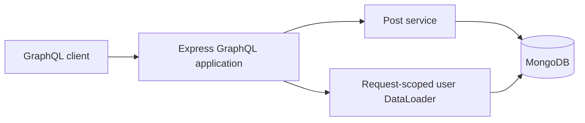
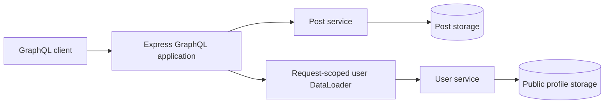
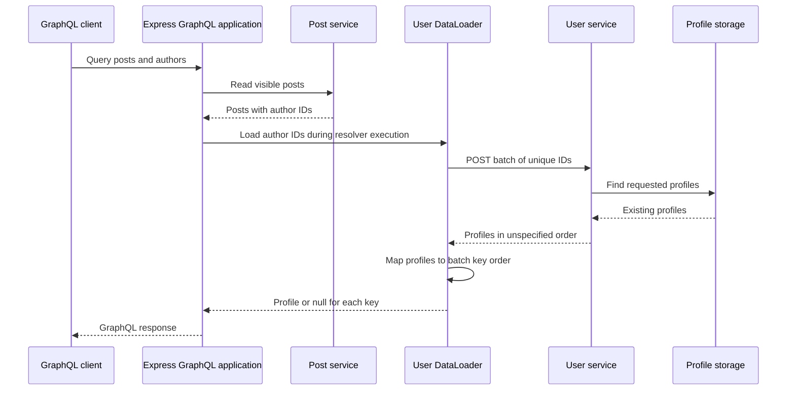
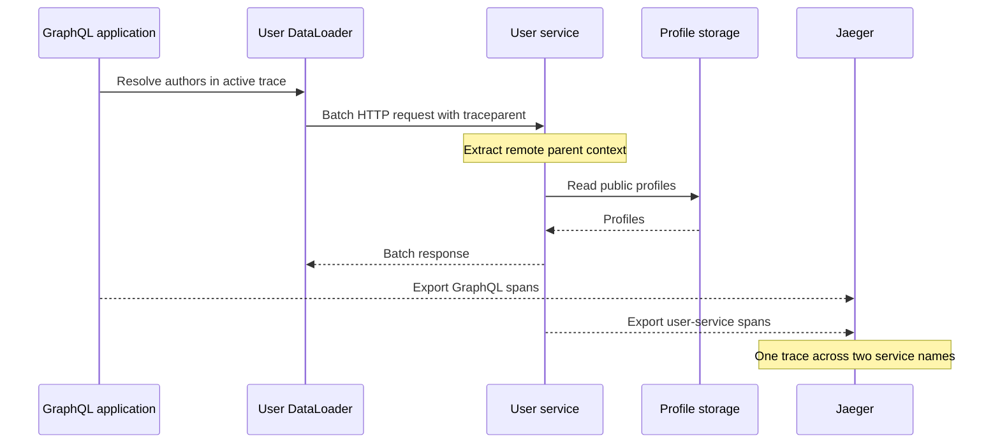

# Distributed GraphQL

## Goal

Explore how our Express GraphQL API retrieves data across service boundaries while preserving batching, authorization, and useful partial responses.

We will begin with explicit service calls. Federation remains a design comparison for a later checkpoint.

This document describes the proposed design. Service delegation is not implemented yet.

## Proposed ownership

| Component | Owns |
| --- | --- |
| Express GraphQL application | Public schema, resolvers, request context, and response composition |
| Post service inside the application | Post storage, visibility rules, and post mutations |
| Authentication inside the application | Credentials, sessions, and trusted request identity |
| Separate user service | Public user profiles and batch profile lookup |

The user service will initially expose public profile fields only. Credentials, sessions, and roles remain with authentication.

A public profile lookup must not become a way to retrieve password hashes or grant permissions.

## Current flow

All data access currently happens within one application.



## Proposed flow

Post access stays local. Author profile lookup crosses a network boundary.



These are logical storage ownership boundaries. Separate services do not require separate MongoDB servers for this learning project.

The GraphQL application will stop reading public user profiles directly once delegation is implemented.

## Why batching still matters

Suppose a query returns five posts with these author IDs:

```text
user-2, user-1, user-2, user-3, user-1
```

Without batching, the GraphQL application could send five HTTP requests to the user service.

With request-scoped DataLoader, these lookups can become one batch containing:

```text
user-2, user-1, user-3
```

Calls must reach the same DataLoader instance within its batching window to share a batch. Loading authors one at a time with sequential awaits can still cause multiple requests.

DataLoader's batch function must return one result per supplied key in the original key order, including a missing result when appropriate. The service response may require mapping by ID to satisfy that contract.

The network boundary changes where data comes from. It does not remove the N+1 problem.

## Authorization boundary

The post service continues to decide which posts an actor may read or modify.

The user service owns access rules for the profile data it exposes. For this first exercise, its lookup contract contains public profile data only.

The GraphQL application combines the results into the public schema. Public profile data must not be used as a substitute for trusted session identity or authorization decisions.

## Batch lookup contract

The proposed user-service endpoint is `POST /internal/users/batch`. Our public client still sends GraphQL operations to Express. This HTTP endpoint is an internal dependency used by the GraphQL application's DataLoader.

### Request

```http
POST /internal/users/batch
Content-Type: application/json
```

```json
{
  "ids": ["user-3", "missing-user", "user-1"]
}
```

Initial validation rules:

- Require a JSON object containing only `ids`.
- Require `ids` to be an array with 1 to 100 entries.
- Require each ID to be a nonempty string of at most 256 characters.
- Treat IDs as opaque values: do not trim them or change their case.
- Allow repeated IDs; deduplicate them before querying storage.
- Bound the JSON request body to 32 KiB.

The 100-entry bound limits work per service call. It is an initial learning-project policy, not a measured capacity limit. Configure DataLoader's `maxBatchSize` to match it when implementing delegation. Larger batches must be split rather than sent as oversized requests.

### Successful response

```json
{
  "users": [
    { "id": "user-1", "displayName": "Ada" },
    { "id": "user-3", "displayName": "Linus" }
  ]
}
```

Return HTTP 200 with the existing requested profiles. Missing IDs are omitted; if none exist, return `{ "users": [] }`.

Each returned ID appears at most once and must have been requested. Response order is unspecified. Each profile contains only `id` and `displayName`, both strings. The user service maps its stored `name` to `displayName`; storage documents and authentication fields do not cross this boundary.

The GraphQL application validates the response before using it. Invalid JSON, malformed profiles, duplicate response IDs, and unrequested IDs are dependency failures, not evidence that users are missing.

### Mapping back to DataLoader keys

The batch function maps profiles by ID and then reconstructs the requested order:

```text
Batch keys:       [user-3, missing-user, user-1]
Service response: [Ada/user-1, Linus/user-3]
Batch results:    [Linus/user-3, null, Ada/user-1]
```

A missing profile produces `null` for that key. An unavailable service rejects the batch: it must not return an array of nulls that disguises an outage as missing data.

The public GraphQL schema continues to support both `User.name` and `User.displayName`. Its mapper can populate both fields from the service's `displayName` during the existing deprecation period.

### Endpoint outcomes

| Situation | HTTP status | Meaning |
| --- | --- | --- |
| Valid lookup, including missing IDs | 200 | Requested existing profiles are returned |
| Invalid request shape, IDs, or batch size | 400 | Caller must correct the request |
| Body exceeds 32 KiB | 413 | Caller must send a smaller body |
| Unsupported request content type | 415 | Caller must send JSON |
| Profile storage is unavailable | 503 | Dependency failed; no successful lookup result |
| Unexpected server failure | 500 | Internal failure; no successful lookup result |

Error responses use a generic envelope, for example:

```json
{
  "error": {
    "code": "SERVICE_UNAVAILABLE",
    "message": "User service temporarily unavailable"
  }
}
```

Do not include database details, credentials, or session tokens in responses. Internal service access controls, deadlines, and GraphQL error mapping are defined in the next checkpoint; the `/internal` path alone does not restrict access.

### Request sequence



This is the successful lookup path. The next checkpoint defines how failures affect nullable and non-null GraphQL fields.

## Deadlines and failure behavior

Each outgoing user-service batch lookup gets a 500 ms deadline. This is an initial local-development policy, not a production latency target derived from measurements.

The deadline covers the HTTP request, reading the response body, and asynchronous response processing until the lookup settles. Keep the abort timer active while reading the body, and clear it in `finally`. An abort signal cancels cooperative network work; it cannot preempt synchronous JavaScript such as JSON parsing. Bounded response sizes keep that work limited.

Initial client policy:

- Send one attempt per batch, with no automatic retry.
- Abort the outgoing request when its deadline expires.
- Bound response bodies to 256 KiB, enforcing the limit while reading even when Content-Length is absent or incorrect.
- Validate the response before resolving any batch results.
- Treat network errors, non-200 responses, invalid responses, and exceeded deadlines as dependency failures.
- Do not replace dependency failures with empty successful results.

The response budget assumes the profile bounds defined below. Validate those bounds in the service and verify maximum-size serialized responses in tests before implementation is enabled.

Retries can multiply load during an outage. We will first make failure behavior predictable before considering bounded retries or a circuit breaker.

This deadline applies to each user-service call. It is not a complete GraphQL operation timeout and does not cap every other resolver or database operation.

## GraphQL nullability and partial responses

The existing application schema declares:

```graphql
type Post {
  id: ID!
  title: String!
  author: User
  status: PostStatus!
}
```

`author` is nullable because it has no exclamation mark. GraphQL can therefore return a post even when its author is unavailable.

| Lookup outcome | Author field | GraphQL errors |
| --- | --- | --- |
| Profile exists | Public user object | None from the lookup |
| Valid response omits the requested ID | null | None from the lookup |
| Deadline exceeded | null | SERVICE_UNAVAILABLE at the author field path |
| Network error or non-200 response | null | SERVICE_UNAVAILABLE at the author field path |
| Malformed or oversized response | null | SERVICE_UNAVAILABLE at the author field path |

During delegation, update the author resolver's current database-specific error message to a generic dependency message such as `Author information temporarily unavailable`. Preserve the `SERVICE_UNAVAILABLE` code, and keep internal failure details in observability data rather than the public error.

### Missing profile example

For a query selecting a post's ID, title, and author, an absent profile produces a normal null result:

```json
{
  "data": {
    "post": {
      "id": "post-1",
      "title": "Learning GraphQL",
      "author": null
    }
  }
}
```

### Dependency failure example

An unavailable service also leaves the author null, but includes an error so clients can distinguish failure from missing data:

```json
{
  "errors": [
    {
      "message": "Author information temporarily unavailable",
      "path": ["post", "author"],
      "extensions": { "code": "SERVICE_UNAVAILABLE" }
    }
  ],
  "data": {
    "post": {
      "id": "post-1",
      "title": "Learning GraphQL",
      "author": null
    }
  }
}
```

Locations are omitted from this illustrative response. A list query identifies the affected author with a path such as `["posts", "edges", 0, "node", "author"]`. Aliases change the corresponding response-path names.

One failed batch can affect several author fields. GraphQL may report an error at each affected field path, even though the loader made only one failed HTTP request. Successful post data and unrelated fields remain available.

HTTP 200 alone does not establish GraphQL success: clients and load tests must inspect the `errors` array as well as `data`.

### What if author were non-null?

Changing the field to `author: User!` would change its failure boundary. GraphQL propagates a null or resolver error upward until it reaches a nullable field.

For the current connection shape:

```text
Post.author: User!             hypothetical non-null author
PostEdge.node: Post!           cannot contain the null post
PostConnection.edges: [PostEdge!]!  cannot contain a null edge
Query.posts: PostConnection!   cannot contain a null connection
Result: data becomes null for the operation
```

For `Query.post: Post`, the nullable root post field would stop propagation and become null instead. Keeping `author: User` preserves useful post data during a profile-service failure without changing the existing schema.

## Failure verification plan

| Scenario | Expected evidence |
| --- | --- |
| Repeated author IDs | Deduplicated IDs in each batch; results map to original keys |
| One requested profile is missing | Only that author is null; no dependency error |
| Service responds after the deadline | Lookup is aborted; affected authors are null with errors |
| Service cannot be reached | Same public dependency error; post fields remain available |
| Service returns invalid JSON or profile data | Batch fails rather than silently treating profiles as missing |
| Response exceeds the byte limit | Reading stops and the batch fails |
| One batch fails for several posts | Error paths identify affected authors; no request per post |
| Query does not select author | No user-service lookup |

These are planned checks, not completed implementation tests.

## Trace propagation

Both processes will export traces to the existing Jaeger container. Use distinct service names:

| Process | Planned OTEL_SERVICE_NAME |
| --- | --- |
| GraphQL application | graphql-engineering-lab |
| User service | graphql-user-service |

The trace ID connects the whole request. Each operation gets its own span ID. Do not create a new independent root trace for the user-service call.



Planned span hierarchy:

```text
POST /graphql                            GraphQL application
  request handler
    graphql.posts
      MongoDB posts lookup
    dataloader.users.batch
      outgoing HTTP batch request
        POST /internal/users/batch       User service
          MongoDB profile lookup
```

This is a conceptual hierarchy; automatic instrumentation may introduce additional middleware spans.

The outgoing request propagates W3C `traceparent` and, when present, `tracestate`. The user service extracts the context before handling the request. Use OpenTelemetry propagation APIs or verified automatic instrumentation rather than constructing these headers manually. Do not forward arbitrary inbound headers or baggage to the dependency.

The current application configures HTTP, Express, and MongoDB instrumentation. That alone is not evidence that a future HTTP client is instrumented. Choose the client during implementation, verify propagation with that client, and avoid creating duplicate client spans through both manual and automatic instrumentation.

Initialize telemetry before loading instrumented application libraries in each process, following the existing [local tracing setup](tracing.md).

### Useful span attributes and logs

Record bounded operational details:

- Batch input count and unique ID count.
- Returned profile count.
- Configured deadline in milliseconds.
- Dependency outcome: success, timeout, network failure, HTTP failure, or invalid response.
- HTTP response status when one exists.

Do not attach passwords, raw session cookies, internal service credentials, full bodies, or author ID lists to new dependency spans. Counts are sufficient for batching verification. Avoid including credentials in exception messages or logged request headers.

Each service may generate its own local request ID. Correlate requests across services with the trace ID; request IDs do not need to be equal. An HTTP 200 GraphQL response can still contain resolver errors, so record the failed batch span independently of HTTP status.

Trace export remains best effort. A Jaeger outage must not turn a successful profile lookup into an application failure.

## Internal service access and Docker deployment

The proposed user service listens on port 4001 inside Docker and is addressed by Compose service name:

```text
GraphQL application -> http://user-service:4001/internal/users/batch
```

Do not use `localhost:4001` from the backend container: that address refers to the backend container itself.

Deployment plan:

- Add a `user-service` Compose service without a host `ports` mapping.
- Keep the GraphQL application as the browser-facing entry point.
- Configure the service base URL through the backend environment, not GraphQL inputs.
- Keep credentials and sessions in the existing application ownership boundary.
- Give the user service access only to the profile storage it needs when storage permissions are introduced.
- Keep the existing MongoDB server for the local exercise; document any transitional shared storage explicitly before coding.

A missing host port mapping limits direct host access but does not authenticate callers. Containers sharing a reachable network may still call the endpoint. CORS and an `/internal` URL prefix are not service authentication.

### Initial service credential

For this local exercise, require a separate shared service token in the batch request's `Authorization: Bearer ...` header. This is a service credential, not a user's session token and not a JWT.

- Supply the same dedicated token to the backend client and user-service verifier through local environment configuration.
- Keep its value out of Git, documentation examples, logs, traces, and public GraphQL responses.
- Fail service startup when the required token is missing; do not silently permit anonymous internal requests.
- Reject missing or invalid tokens with HTTP 401 before profile lookup.
- Do not forward browser cookies or browser Authorization headers to the user service.
- Map an upstream 401 to the generic GraphQL dependency error; clients cannot repair an internal credential mismatch by logging in again.

The token authenticates the calling service only. It grants no user role and does not replace post authorization.

Local container-to-container HTTP is the learning setup. A deployment across untrusted networks needs protected transport and an appropriate service-identity and secret-management mechanism. The shared-token exercise is not a complete production deployment design.

### Verification checkpoint

| Scenario | Expected evidence |
| --- | --- |
| Query selects authors | One trace includes GraphQL and user-service spans under different service names |
| Repeated author IDs | Batch counts show deduplication; HTTP calls correspond to batches |
| User-service request logs | Local request ID and the same trace ID as the originating GraphQL request |
| Missing or invalid service token | HTTP 401 and no profile database lookup |
| Internal credential mismatch | GraphQL author dependency error, without leaking credential details |
| Jaeger unavailable | API behavior remains independent of trace export |
| Inspect Compose configuration | No user-service host port published; secrets are not committed |

These checks remain planned until implementation.

## Profile bounds and payload budgets

Initial profile contract:

- `id` is a nonempty string of at most 256 JavaScript UTF-16 code units, matching request-ID validation.
- `displayName` is a nonempty string whose UTF-8 encoding is at most 128 bytes.
- Return only those two fields in each profile object.
- Return at most one profile per unique requested ID and at most 100 profiles.

The display name is a public label, not a credential or authorization input. Validate existing stored names before enabling this endpoint. An invalid stored profile is a service failure, not a missing user; do not truncate names silently or change existing authentication behavior as part of this exercise.

The 256 KiB response limit allows room for JSON escaping at these bounds. A conservative estimate allows six ASCII bytes per ID code unit and six bytes per display-name UTF-8 byte:

```text
ID allowance per profile:       256 x 6 = 1,536 bytes
Name allowance per profile:     128 x 6 =   768 bytes
Values for 100 profiles: 100 x 2,304 = 230,400 bytes
Remaining response budget:       262,144 - 230,400 = 31,744 bytes
```

The remaining space covers the fixed object keys, punctuation, and envelope in compact JSON. Test the actual serializer with boundary inputs; this estimate does not replace enforcing the byte limit while reading.

The 32 KiB request limit is an independent aggregate bound. Some arrays containing 100 individually valid IDs can exceed it after JSON escaping. The client must split batches to satisfy both the entry count and serialized request-body byte limit, or fail safely if one entry cannot fit. `maxBatchSize: 100` addresses only the count bound.

These are deliberately explicit learning-project limits. Revisit them with real profile requirements and measurements rather than treating them as universal defaults.

## Transitional storage ownership

Current authentication code reads `users` during credential verification, account provisioning, and session resolution. The seed command also writes that collection. Moving public author lookups to another process does not automatically remove these dependencies.

For the first implementation:

| Operation | Initial owner or access path |
| --- | --- |
| Read authors for post GraphQL fields | User service through batch HTTP lookup |
| Read profiles for existing authentication behavior | Existing application code, directly from users |
| Read and write credentials and sessions | Existing authentication code |
| Seed user profiles | Existing seed command |
| Read and mutate posts | Existing post service |

Both processes initially use the same local MongoDB database, with the user service reading the existing `users` collection. Do not copy profile data into a second collection, introduce synchronization, or move credentials during this first exercise.

The user-service query projects only profile fields. This application-level restriction is not database-level isolation: a shared unrestricted MongoDB connection would still permit broader access. Separate database credentials and permissions are future hardening work.

This is a service-call extraction with transitional shared storage, not complete independent data ownership. A later ownership migration must decide how authentication gets its required identity information, who writes profiles, and how account lifecycle changes remain consistent. Do not add a user-service dependency to login or session resolution implicitly.

## Why start with explicit delegation?

Our first design keeps one public GraphQL schema in Express. Its author resolver delegates public-profile lookup through DataLoader to an internal HTTP endpoint. The user service does not need to expose GraphQL for this exercise.

| Concern | Explicit service delegation in this project | Apollo Federation alternative |
| --- | --- | --- |
| Public schema | Defined in the existing GraphQL application | Composed from subgraph schemas |
| Cross-service lookup | Our loader and HTTP client choose batch calls | A router plans calls using the composed schema |
| Shared object identity | Our lookup contract uses user IDs | Entity keys describe identity across subgraphs |
| Schema coordination | Application schema and internal contract are reviewed together | Composition checks whether subgraph schemas can form a valid supergraph |
| Batching | We implement and verify it | Entity resolvers may still need DataLoader |
| Operational work | One additional service plus client configuration | Subgraphs, composition, router configuration, and compatibility checks |
| Failure controls | We define deadlines, errors, authorization, and tracing | Those policies still require deliberate design across components |

Federation's composition combines subgraph schemas with routing metadata. Entity keys allow a router to associate fields belonging to the same object across subgraphs. These mechanisms address schema and ownership coordination; they do not eliminate N+1 inside a reference resolver. See Apollo's [schema composition documentation](https://www.apollographql.com/docs/graphos/schema-design/federated-schemas/composition) and [entity documentation](https://www.apollographql.com/docs/graphos/schema-design/federated-schemas/entities/intro).

Our decision is to learn the network boundary explicitly first: batching, deadlines, partial failure, tracing, and service credentials. Federation is a useful later exercise when we want to explore schema composition and ownership across GraphQL subgraphs. It is not required simply because a resolver calls another service.

## Design walkthrough

| Scenario | Planned behavior |
| --- | --- |
| Successful posts query | Local visibility filtering, then bounded profile batches; results mapped by ID |
| Five posts share three authors | Three unique IDs in one batch when calls share a batching window and fit both limits |
| One author profile is missing | That author is null without a dependency error |
| User service is unavailable | Affected authors are null with SERVICE_UNAVAILABLE; other selected post fields remain |
| Query selects no author field | No profile-service request |
| Caller lacks the service credential | Internal endpoint returns 401 before database lookup |

## Next implementation checkpoints

This ticket remains design-only. Review and commit the design before opening the implementation work.

1. Build the bounded user batch endpoint with service-token verification and tests.
2. Add it to Docker Compose and initialize its tracing before application imports.
3. Implement a bounded HTTP client with response validation, deadline handling, and propagated trace context.
4. Adapt the request-scoped author loader and shared public-user mapper, preserving the public schema.
5. Test missing profiles, service outages, invalid responses, payload limits, and tracing across processes.

Each checkpoint should be small enough to review and verify independently. Existing authentication and post-authorization tests must continue to pass when implementation begins.
