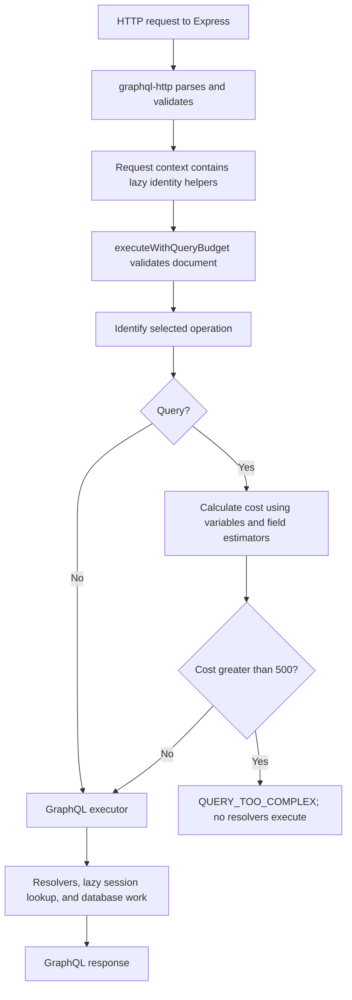

# GraphQL query complexity budget

The `/graphql` endpoint now checks query cost before resolver execution. Unit and
HTTP integration tests passed, and the running playground was manually verified:
ordinary requests work, a 560-point query is rejected, and the same query with a
smaller page size is allowed. Confirm final checks and CI before merging issue #56.

## Why pagination is not enough

Each `posts` invocation allows at most 20 posts. A query can still request many
separate lists through aliases. Pagination bounds one list; a complexity budget
bounds the estimated work of the selected operation as a whole.

DataLoader addresses repeated/batched author loading, but it does not limit how
much data a client requests. Complexity admission and DataLoader solve different
problems and remain enabled together.

## Request flow



The diagram describes the conceptual stages, not the exact order of context
construction within graphql-http. Context construction creates helpers but does
not perform session lookup; `getActor()` remains lazy. Over-budget requests can
produce HTTP request logs, but their operation resolvers do not execute.

The wrapper also validates documents so it can be tested and used independently.
The HTTP handler already performs standard validation, so valid HTTP operations
currently undergo a second validation pass. That is a deliberate simplicity tradeoff,
not a requirement for cost estimation itself.

## Dependency and configuration

The project pins `graphql-query-complexity` to 2.0.0. Its declared GraphQL peer
range includes `^17.0.0`, compatible with the installed GraphQL 17 dependency.
The library handles document traversal; application code supplies the field policy.

| Setting | Current value | Location |
| --- | --- | --- |
| Query budget | 500 points | QUERY_COMPLEXITY_LIMIT in src/query-complexity.ts |
| Analysis traversal guard | maxQueryNodes: 10,000 | src/execute-with-query-budget.ts |
| Default posts page size | 5 | Existing pagination policy |
| Maximum posts page size | 20 | Existing pagination policy |
| Enforced operation type | Queries only | Execution wrapper |

These settings are code configuration, not environment variables. Scores equal to
500 are allowed; scores greater than 500 are rejected. The library's traversal
guard is separate from the score budget and is not a query-depth limit.

## Field cost model

| Field | Formula |
| --- | --- |
| Ordinary scalar or object field | 1 + childComplexity |
| Post.author | 5 + childComplexity |
| Query.posts | 10 + requested page size * childComplexity |

`childComplexity` is the sum of the selected child field costs. Scalars have no
children, so their cost is 1. The estimator returns the total for its field;
children are not then added a second time. Root sibling costs are added to obtain
the selected operation's score.

The weights are provisional learning choices, not benchmark-derived ratios:

- 1 gives ordinary selected fields a nonzero baseline.
- 5 distinguishes author relationship work from copying a stored scalar.
- 10 gives every posts invocation a base charge for list setup/query work.
- 500 permits ordinary examples while rejecting sufficiently wide operations.

These are work points, not milliseconds, memory estimates, response bytes, or
exact database-call counts. The model does not assume one database call per author
or predict DataLoader cache hits. It conservatively charges each requested author
selection even when the loader batches and deduplicates IDs.

Query.posts multiplies the entire connection selection. This also multiplies
pageInfo metadata that is actually returned once per connection. The one-document
pagination lookahead is not modeled exactly. Other database-backed fields such as
post and me currently receive the ordinary baseline; their relative costs may
need tuning from traces and load tests.

## Worked calculations

### Minimal list

```graphql
query {
  posts(first: 2) {
    edges {
      node {
        id
      }
    }
  }
}
```

```text
id                           = 1
node childComplexity         = id = 1
node                         = 1 + 1 = 2
edges childComplexity        = node = 2
edges                        = 1 + 2 = 3
posts childComplexity        = edges = 3
posts(first: 2)              = 10 + 2 * 3 = 16
operation                    = 16

Same selection, first: 20    = 10 + 20 * 3 = 70
Omitted first, default 5     = 10 + 5 * 3 = 25
```

### List with author

```graphql
query {
  posts(first: 2) {
    edges {
      node {
        id
        author {
          name
        }
      }
    }
  }
}
```

```text
id                           = 1
name                         = 1
author                       = 5 + name = 6
node childComplexity         = id + author = 1 + 6 = 7
node                         = 1 + 7 = 8
edges                        = 1 + 8 = 9
posts(first: 2)              = 10 + 2 * 9 = 28
```

### Aliases and the budget

Eight separately aliased minimal lists, each with first: 20:

```text
Each list                    = 10 + 20 * 3 = 70
Eight lists                  = 8 * 70 = 560
Budget                       = 500
Result                       = reject before execution

Same query, first: 1         = 8 * (10 + 1 * 3) = 104
Result                       = allow execution
```

Aliases rename response keys, not schema field identities. Every aliased posts
selection still receives the Query.posts cost rule. Named and inline fragments
contribute the selected fields they contain, without a separate fragment-wrapper
charge. Syntax-based estimation can conservatively count repeated selections;
it is not an exact prediction of GraphQL field merging or database execution.

## Variables, operations, and validation

- Use actual request variables and operation-variable defaults for pagination.
- Reuse existing page-size validation: invalid sizes fail rather than execute.
- When multiple operations exist, score only the operation selected by operationName.
- Preserve normal errors for missing or ambiguous operation selection.
- Standard document validation runs before analysis, including fragment-cycle checks.
- Include/skip directive values affect which selections contribute cost.
- Invalid variable/argument errors do not fall through to execution.
- Unexpected analysis failures return a generic INTERNAL_SERVER_ERROR.

## Rejection response

An operation costing 560 returns a response with no data field:

```json
{
  "errors": [
    {
      "message": "Query exceeds the complexity limit",
      "extensions": {
        "code": "QUERY_TOO_COMPLEX",
        "complexity": 560,
        "maximumComplexity": 500
      }
    }
  ]
}
```

This is admission failure before field execution, so it has no resolver error path.
Inspect GraphQL errors rather than assuming HTTP 200 establishes success. HTTP
integration tests cover GET/POST and both application/json and
application/graphql-response+json without using status alone as proof of admission.

## Introspection and mutations

Standard generated introspection is tested under the same budget. The actual
playground was also reloaded and manually verified after enabling the wrapper.
There is no exemption based on the client-controlled name IntrospectionQuery.
Schema changes or a different introspection document may change the score and
should be checked before adjusting the policy.

Mutations bypass this query budget. Login retains its own attempt/concurrency
protections, and post mutations retain request guards and service authorization.
This does not provide a general budget against wide mutation aliasing. Extending
cost enforcement to writes requires a separate cost policy and tests.

## Implementation and verification

Paths below are relative to backend/.

| File | Responsibility |
| --- | --- |
| src/query-complexity.ts | Application weights and query budget with rationale |
| src/query-complexity.test.ts | Exact scores for fields, pages, aliases, fragments, variables, directives, and operation selection |
| src/execute-with-query-budget.ts | Validate, select operation, calculate cost, reject or execute |
| src/execute-with-query-budget.test.ts | Zero-resolver rejection, exact boundary, standard validation, introspection, and mutation behavior |
| src/query-budget-http.test.ts | Temporary Express/graphql-http endpoint with resolver counters |
| src/main.ts | Pass executeWithQueryBudget as the real handler's execute option |

HTTP tests use stub resolvers to isolate request admission from database behavior.
Zero resolver calls prove over-budget operation work never starts in those tests.
They do not load main.ts or measure production performance. Service integration
tests that invoke graphql() directly bypass this HTTP wrapper and test a different
boundary.

```bash
docker compose exec backend npm run format:check
docker compose exec backend npm run typecheck
docker compose exec backend npm test
docker compose --profile test run --rm integration-tests
```

Manual playground verification:

1. Reload the editor and confirm schema discovery/autocomplete works.
2. Run an ordinary post query successfully.
3. Send eight minimal aliased lists with count=20 and confirm the 560-point rejection.
4. Change count to 1 and confirm execution is allowed at 104 points.
5. Correlate request logs and confirm no post resolver DB-call logs for the rejection.

## Limits and follow-up work

- [Depth validation](query-depth.md) now runs alongside standard validation before complexity analysis (issue #32).
- This is per-operation admission, not request-rate limiting or a global workload cap.
- Parsing, HTTP input handling, validation, and analysis still consume resources
  before execution. Body-size limits and parser/validation protections are separate.
- Timeouts, persisted queries, response-size limits, and general mutation budgets
  are not implemented by this feature.
- Introspection contains lists that do not use the posts multiplier. Keep its
  coverage and review broader introspection-resource policies separately.
- Review new list fields and expensive resolvers when evolving the schema; the
  fallback baseline does not automatically capture new cardinality or I/O costs.
- Recalibrate weights and the budget using representative operations and measured
  behavior; current numbers are not a proven production capacity threshold.

