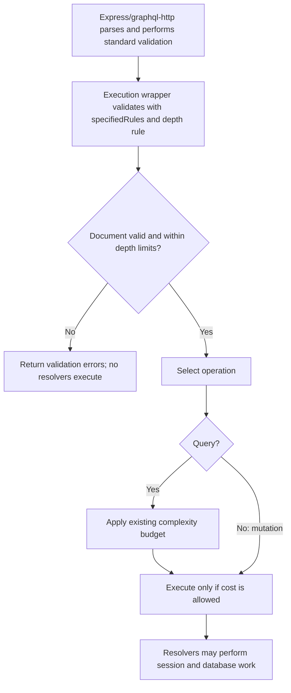

# GraphQL depth validation

Issue #32 adds depth validation before complexity analysis and resolver execution.
The application keeps its 500-point query complexity budget. Depth and complexity
are complementary controls: depth limits nesting; cost estimation accounts for
selected work and list sizes.

## Counting depth

Count fields with nested selections on the longest path. The root operation
wrapper and scalar leaves do not add levels. Sibling selections do not add their
depths together.

```graphql
query {
  posts {          # Level 1
    edges {        # Level 2
      node {       # Level 3
        title      # Scalar: no extra selection level
        author {   # Level 4
          name     # Scalar: no extra selection level
        }
      }
    }
    pageInfo {     # Level 2 on another, shorter path
      hasNextPage
      endCursor
    }
  }
}
```

The longest path is posts -> edges -> node -> author: depth 4. This is accepted.
Adding more scalar siblings does not increase depth, although it increases cost.

## Configuration

The project pins `@graphile/depth-limit` to 0.4.0, whose GraphQL peer range is
`>=15 <18`. The application uses GraphQL 17.0.2.

| Option | Value | Purpose |
| --- | --- | --- |
| maxDepth | 4 | Preserve the current paginated posts/author path |
| maxListDepth | 2 | Bound nesting through lists of objects separately |
| maxSelfReferentialDepth | 4 | Bound repetition of the same schema field along one path |
| fragmentsAddToDepth | false | Expand fragment fields without charging an extra wrapper level |
| revealDetails | true | Explain the violated limits in learning-project errors |
| Introspection options | Package defaults | Preserve normal schema discovery with separate limits |

These are initial policy choices, not measured production capacity thresholds.
Depth validation applies to query and mutation documents. The existing cost budget
continues to apply only to queries.

### Overall depth versus repeated fields

Our recursive test schema has:

```graphql
type Node {
  name: String!
  child: Node
}
```

`Node.child` is a schema coordinate: field child on type Node. Because child
returns another Node, the field can be selected repeatedly along a path.

```graphql
query {
  node {          # Overall depth 1
    child {       # Overall depth 2; Node.child occurrence 1
      child {     # Overall depth 3; Node.child occurrence 2
        name
      }
    }
  }
}
```

| Measurement | Count |
| --- | --- |
| Overall depth: node -> child -> child | 3 |
| Repeated occurrences of Node.child on the path | 2 |

Now add two more child selections:

```graphql
query {
  node {                # Overall depth 1
    child {             # Overall depth 2; occurrence 1
      child {           # Overall depth 3; occurrence 2
        child {         # Overall depth 4; occurrence 3
          child {       # Overall depth 5; occurrence 4
            name
          }
        }
      }
    }
  }
}
```

Four repetitions satisfy maxSelfReferentialDepth: 4, but overall depth 5 exceeds
maxDepth: 4. The operation is rejected by the overall depth rule.

We chose the repetition limit of four so the separate default repetition limit of
two would not reject our intended depth-four boundary example first. That example
has node plus three child selections: overall depth 4, but Node.child occurs 3 times.

A future policy could permit a larger overall depth while restricting a specific
relationship more tightly. These are independent measurements, and all limits must
pass. Counts apply to a nested path: sibling aliases are not nested repetitions.
The recursive fields belong to tests, not the application schema.

### Nested lists

An ordinary object does not count as another list. In the application connection,
PostConnection.edges is a list of objects, while posts, node, and author are objects:
list depth 1.

In the recursive test schema, friends returns a list of Node objects:

```graphql
query {
  node {
    friends {       # List 1
      friends {     # List 2
        friends {   # List 3
          name
        }
      }
    }
  }
}
```

This path has overall depth 4 but list depth 3. It violates maxListDepth: 2.
The companion limit catches a different property of the same selection path.

### Fragments and introspection

`node { ...Fields }` with Fields selecting `child { name }` has the same depth as
`node { child { name } }`: 2. Named and inline fragments cannot hide deeper selected
fields. The fragment wrapper itself does not add a level.

Schema introspection uses the package's separate default limits. It is not exempt
based on the client-controlled operation name. Standard generated introspection
is covered by validation and HTTP tests; also reload the actual playground when
verifying the feature.

## Execution order and errors



The wrapper retains specifiedRules alongside the depth rule. It does not replace
normal GraphQL validation. Its validation pass is additional to the HTTP handler's
existing standard validation. Context creation remains lazy and does not resolve
sessions before operation admission.

Depth validation checks the document's operations, including unselected operations
in a multi-operation document. Complexity analysis subsequently scores only the
selected operation. Depth counting is structural; it does not rely on runtime
variables to omit selections through include/skip directives.

Depth rejection returns errors without a data field. The dependency supplies a
message describing the violated limit because revealDetails is true; this feature
does not add a custom depth error extensions.code. Inspect the response errors,
not HTTP status alone. No resolver error path is expected for validation rejection.

The application uses the same wrapper already configured as the handler's execute
option, so no second main.ts enforcement hook is needed.

## Why shallow queries can still be expensive

Eight aliased lists selecting posts -> edges -> node { id } each have depth 3.
Adding aliases does not increase the longest path or nested repetition count.
The depth rule accepts the document, but the complexity budget rejects it:

```text
Each first: 20 list           = 10 + 20 * 3 = 70 points
Eight sibling lists          = 8 * 70 = 560 points
Allowed complexity budget    = 500 points
Result                       = QUERY_TOO_COMPLEX before execution
```

See [the complexity policy](query-complexity.md) for the field-cost calculation.
Depth limits alone do not bound width, list cardinality, field expense, request
rate, response bytes, or execution time.

## GraphQL type identity and the ESM loader

The first tests exposed a runtime incompatibility under the previous tsx runner.
Although the dependency declared GraphQL 17 compatibility, the app and depth package
received different ESM/CommonJS GraphQL type implementations under that loader.
The depth package did not recognize nested object types and reported depth 1 for
operations that should have depths 4 and 5. Nested-fragment and list tests also
failed to reject their operations.

Direct Node execution counted correctly. The targeted test file then passed all
seven initial tests unchanged using node --import tsx/esm. Package scripts now
start Node with the ESM-only loader for dev, unit tests, and integration tests.
Development uses Node watch mode and preserves the OpenTelemetry preload/hooks.

This demonstrates why peer-dependency compatibility alone is insufficient: tests
must prove rejection, not just successful installation or acceptance of valid queries.
The correct fix preserved boundary assertions instead of changing expected depths
to match the broken traversal.

## Implementation and verification

Paths below are relative to backend/.

| File | Responsibility |
| --- | --- |
| src/query-depth.ts | Depth rule, limits, and examples |
| src/query-depth.test.ts | Boundary, fragments, list depth, introspection, execution counters, and shallow-width example |
| src/query-depth-http.test.ts | Temporary recursive-schema HTTP endpoint; GET/POST admission and zero-resolver rejection |
| src/execute-with-query-budget.ts | Depth validation before complexity and execution |
| src/query-budget-http.test.ts | Existing real application-schema HTTP and introspection coverage |
| package.json | ESM-only TypeScript loader for consistent GraphQL type identity |

Recursive test schemas permit valid deeply nested operations without adding
artificial relationships to the application. HTTP tests use stub resolvers rather
than MongoDB. A zero call counter proves rejected operation resolvers never start;
this also prevents database work those resolvers would initiate. These temporary
servers do not load main.ts or verify production capacity.

```bash
docker compose exec backend npm run format:check
docker compose exec backend npm run typecheck
docker compose exec backend npm test
docker compose --profile test run --rm integration-tests
```

After changing startup scripts, restart the backend and verify health, playground
schema discovery, and source-file reload. Confirm normal paginated post queries
still work. The application's current graph has no ordinary path deeper than four;
recursive boundary/rejection demonstrations therefore use the dedicated test schema.

Run the final suite and CI before merging; coverage being present does not itself
confirm the latest checks passed.

## Remaining protections

Body-size and parser/validation resource limits, execution deadlines, request-rate
limits, persisted queries, and response-size controls remain separate work. Depth
and the current query budget do not provide a general limit on wide mutations.
Review these policies when new relationships or list fields are added.
