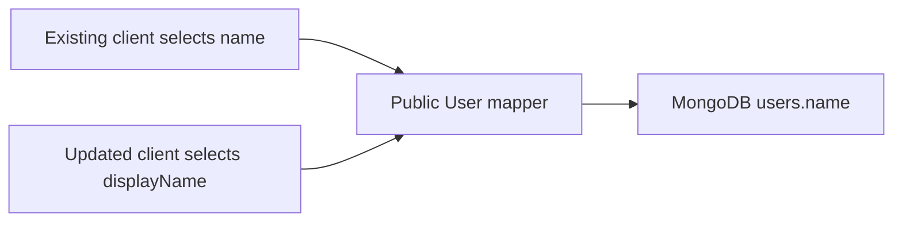
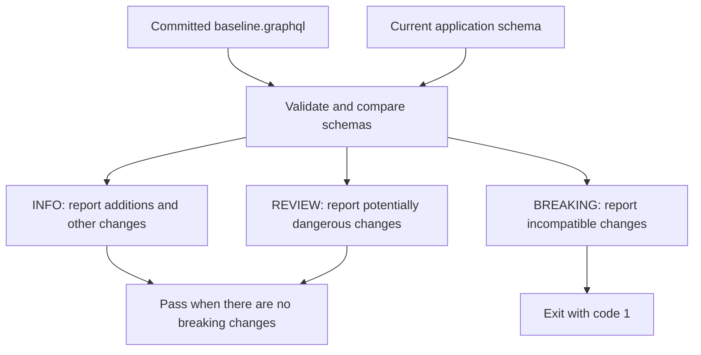

# Schema evolution

Our public `User` type is moving from `name` to `displayName` without requiring every client to change at once.

## The migration

```graphql
type User {
  id: ID!
  name: String! @deprecated(reason: "Use displayName")
  displayName: String!
}
```

Both fields currently return the same MongoDB `users.name` value. There is no database migration. `AuthUser`, used by authentication responses, keeps its existing `name` field.

Deprecation tells clients which field to use next. It does not remove the old field or prevent queries from selecting it.



An existing client can continue querying:

```graphql
query ExistingClient {
  posts(first: 2) {
    edges {
      node {
        author {
          id
          name
        }
      }
    }
  }
}
```

An updated client can replace `name` with `displayName`. Selecting both also works, allowing us to verify that they return the same value during the transition.

## Compatibility checking

`backend/schema/baseline.graphql` records the schema before this migration. The checker compares that committed contract with the current schema exported by `backend/src/graphql.ts`.



Run it through Docker:

```sh
docker compose exec backend npm run schema:check
```

The checker uses GraphQL 17's `findSchemaChanges`. Our helper groups changes using `BreakingChangeType` and `DangerousChangeType`; remaining changes are informational. The review category is conservative and requires human assessment.

| Example change | Our checker's treatment |
| --- | --- |
| Add `User.displayName` | Informational; passes |
| Remove baseline field `User.name` | Breaking; fails |
| Change output `name: String!` to `name: String` | Breaking; fails because clients can now receive null |
| Add a required argument without a default | Breaking; fails |
| Add an enum value | Review; passes, but clients may need to handle another value |

Adding a field is compatible, so a successful check is expected. The checker now prints informational changes to make additions visible. Deprecation metadata is verified separately through introspection tests; structural comparison is not a complete metadata audit.

The command imports the schema without starting Express or connecting to MongoDB. CI runs `schema:check` alongside formatting and TypeScript checks; unit and integration tests run in separate jobs.

## What the tests establish

| Coverage | Purpose |
| --- | --- |
| Compatibility fixtures | Check unchanged schemas, additions, removals, nullability changes, required arguments, and enum additions |
| User introspection | Confirm `name` is deprecated with reason `Use displayName`, while `displayName` is available |
| AuthUser contract | Confirm this public-user migration leaves authentication fields unchanged |
| Post integration queries | Confirm old, new, and combined author selections work for published posts and an authenticated author's draft |

Schema comparison checks the declared contract. Integration tests check that resolvers actually return the expected values. A structurally compatible field can still have a broken resolver, incorrect authorization, or changed meaning.

## Baseline policy and limitations

The baseline is a checked-in file, not a schema fetched from production, a registry, or the target branch. CI compares the baseline present in the same checkout as the proposed code.

The baseline export command uses exclusive file creation (`flag: "wx"`) to avoid accidentally overwriting an existing file. That protects the export command only: someone can still edit the baseline in a pull request, so reviewers must examine baseline changes.

For this feature, keep the original baseline unchanged so it demonstrates that the new schema preserves the previous contract.

A fixed baseline cannot protect fields added after it was captured. For example, it does not yet protect `displayName` against later removal. After reviewing and releasing the additive migration, advance the baseline deliberately to the supported released schema, including both `name` and `displayName`. Do not update it merely to silence a breaking-change failure.

## Before removing a deprecated field

Removing `name` is a separate, potentially breaking change. Before considering it:

1. Communicate the replacement and migration period to client owners.
2. Collect field-usage evidence over an agreed observation window. An absence of recent requests alone does not prove that every supported client has migrated.
3. Account for infrequent consumers, older deployed clients, and persisted operations.
4. Agree on the supported-client policy and removal timing.
5. Review the breaking change explicitly and update the baseline as part of that deliberate contract change.

This project does not yet implement field-usage collection. Request counts and timing traces alone do not establish whether clients still select `User.name`.

## Verification checkpoint

Run these checks before opening the pull request:

```sh
docker compose exec backend npm run format:check
docker compose exec backend npm run typecheck
docker compose exec backend npm test
docker compose exec backend npm run schema:check
docker compose --profile test run --rm integration-tests
```

Confirm in Playground that existing `author { name }` queries and updated `author { displayName }` queries both work. Introspection must expose the deprecation reason. If the running process still serves an older schema after a saved edit, restart the backend and retry.
